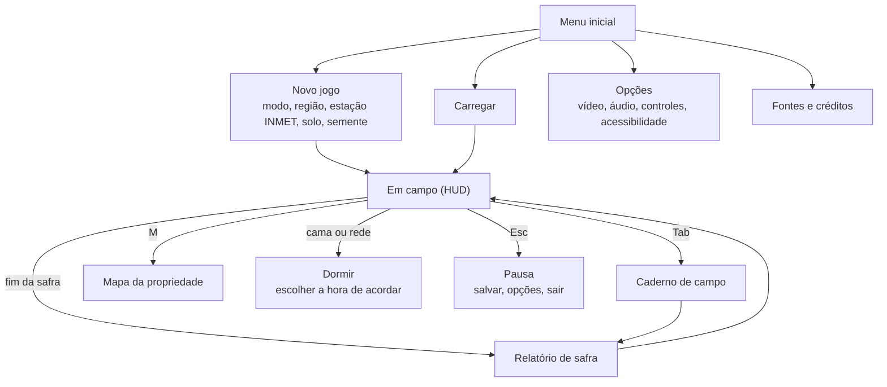
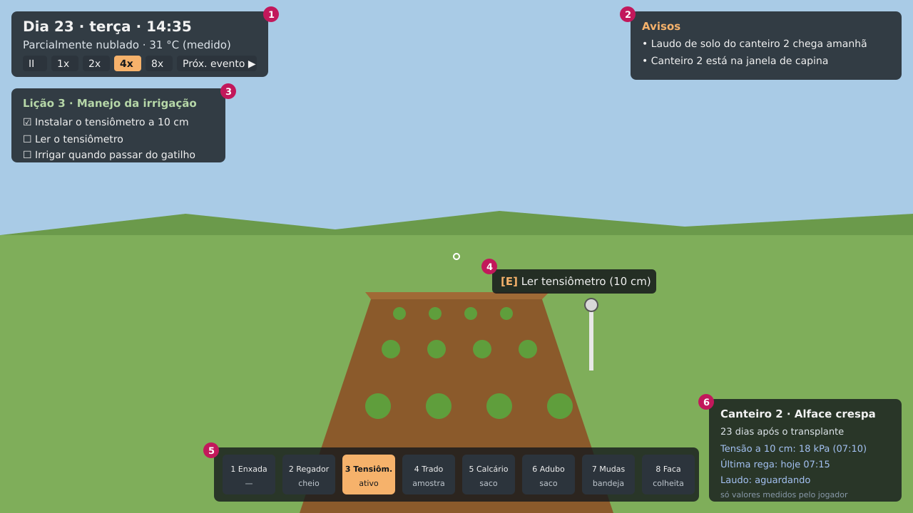
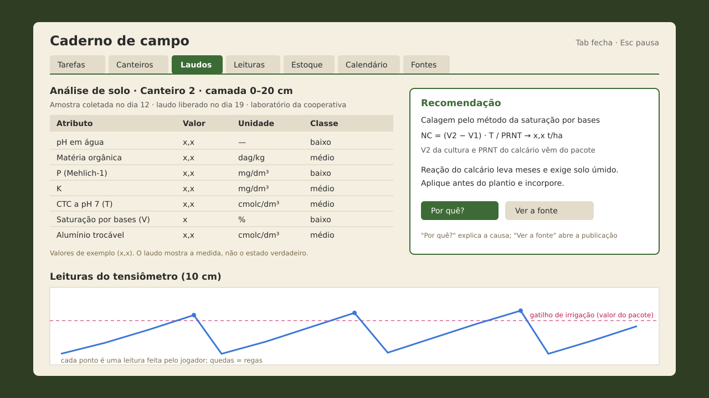
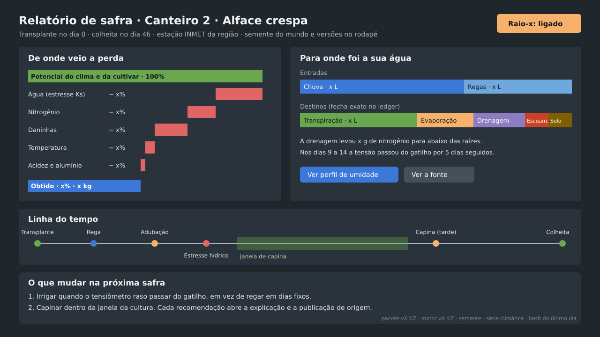

# 13 · Interface

**Estado:** rascunho · **Esforço:** `médio` (`MAPA_DO_PROJETO` §1.2)

## 1. Objetivo
Definir as telas, o HUD, o caderno de campo, o relatório de safra e os controles do simulador. O documento serve a quem implementa a interface no Godot (passo D8) e a quem escreve a campanha (documento 11).

## 2. Escopo e limites
Dentro.
1. Mapa de telas e navegação.
2. HUD em campo, prompt de interação e barra de ferramentas.
3. Caderno de campo com laudos, leituras, estoque, calendário e fontes.
4. Relatório de safra com decomposição da perda, balanço de água e raio-x.
5. Controles do tempo, dormir e pular até o evento.
6. Controles padrão, acessibilidade e escala da interface.

Fora.
1. Verbos, pré-condições e efeitos das operações (documento 08).
2. Câmera e movimento do protagonista (documento 18).
3. Critérios de nota e de avaliação (documento 12).
4. Textos das lições (documento 11).

## 3. Fontes envolvidas

| ID da fonte | O que fornece aqui | Rótulo |
|---|---|---|
| WIKIGG-2024-FS25MANUAL | Elementos de HUD e escala de tempo do Farming Simulator 25, como referência de convenção de jogo | [FONTE:WIKIGG-2024-FS25MANUAL] |
| Nenhuma outra | Números agronômicos mostrados na interface vêm do pacote (documento 14) | [INFERÊNCIA] |

Diretrizes de acessibilidade de jogos e manuais oficiais dos jogos de referência estão na rodada 4 de pesquisa [VERIFICAR].

## 4. Dependências
Precisa de 01 (pedagogia), 02 (contratos `read()` e `act()`), 08 (verbos) e 18 (câmera). Alimenta 11 (campanha), 12 (avaliação) e 16 (testes de interface).

## 5. Contratos e esquemas

### 5.1 Princípios
1. **Verdade invisível.** A tela mostra só o que o jogador mediu, com hora da medida. O estado verdadeiro aparece só no raio-x do relatório de safra e no modo aprendiz (`00_INDICE` §2, princípio 8).
2. **Causa antes de nota.** Todo resultado vem com o porquê e com o botão que abre a publicação registrada.
3. **HUD mínimo.** O campo é a tela principal. Painéis pequenos nos cantos e nada no centro além da mira e do prompt.
4. **Leitura em tela pequena.** A interface é desenhada para 1280 × 720 e escala por fator inteiro ou fracionário. O texto principal tem pelo menos 14 px na resolução base [INFERÊNCIA; diretriz a verificar].
5. **Cor nunca sozinha.** Todo estado com cor também tem texto ou forma.
6. **A interface não muda o mundo.** Ela lê por `read()` e age só por `act(verbo, alvo, insumo)` (`ARQUITETURA_SIMULACAO` §2).

### 5.2 Mapa de telas

### 5.3 HUD em campo

| Nº | Elemento | Conteúdo | Regra |
|---|---|---|---|
| 1 | Relógio e clima | Dia, dia da semana, hora, céu e temperatura medida. Botões de pausa, 1x, 2x, 4x, 8x e pular até o próximo evento. Na campanha também 16x e 32x | A velocidade só muda o ritmo, nunca o resultado (`ARQUITETURA_SIMULACAO` §3.2) |
| 2 | Avisos | Laudo que chega, janela de manejo aberta, evento do modo semiaberto | No máximo três linhas. O resto vai para o caderno |
| 3 | Tarefas da lição | Lição atual e passos com caixa de seleção | Só na campanha |
| 4 | Mira e prompt | Tecla e verbo do que está sob a mira | Aparece só quando há verbo possível |
| 5 | Barra de ferramentas | Oito espaços com ferramenta ou insumo e quantidade | Teclas 1 a 8 ou roda do mouse |
| 6 | Contexto do alvo | Canteiro, cultura, dias após o transplante e as últimas medidas com hora | Só valores medidos |

### 5.4 Interação
1. O item ativo da barra define a ferramenta ou o insumo. A mira define o alvo. O motor oferece os verbos possíveis e o prompt mostra o principal.
2. Ação com custo alto ou sem volta (aplicar defensivo, arrancar a cultura) pede confirmação. A confirmação de defensivo mostra a dose e a carência do registro (Agrofit, pelo pacote).
3. O esforço físico custa tempo de jogo. Capinar um canteiro leva minutos de jogo. Não há fome nem barra de energia (decisão 47).
4. Ação da física (passada de microtrator) vira uma ação quantizada antes de entrar no mundo (`ARQUITETURA_SIMULACAO` §3.3).

### 5.5 Caderno de campo

| Aba | Conteúdo |
|---|---|
| Tarefas | Lição atual, tarefas do dia e janelas de manejo abertas |
| Canteiros | Lista dos canteiros com cultura, idade e última medida de cada instrumento |
| Laudos | Análises de solo e foliar com data de coleta, prazo, valor medido, classe e recomendação com o porquê e a fonte |
| Leituras | Série das leituras de cada instrumento, com o gatilho do pacote como linha de referência |
| Estoque | Insumos, quantidades, validade e carência |
| Calendário | Datas das operações feitas e janelas previstas pela cultura |
| Fontes | Publicações citadas no jogo, com ID, título e link |

### 5.6 Relatório de safra

1. **De onde veio a perda.** Barras em cascata do potencial do clima e da cultivar até o obtido. Cada barra é um fator que o modelo registrou dia a dia (água, nitrogênio, daninhas, temperatura, acidez e alumínio).
2. **Para onde foi a sua água.** Entradas e destinos lidos das contas do ledger. A soma fecha exata. O mesmo painel existe para o nitrogênio.
3. **Linha do tempo.** Operações, janelas de manejo e episódios de estresse.
4. **O que mudar.** No máximo três recomendações, cada uma com o porquê e a fonte.
5. **Raio-x.** Liga o estado verdadeiro (perfil de umidade, N mineral, raiz) sobre a linha do tempo.
6. **Rodapé.** Versões do pacote e do motor, semente, série climática e hash do último dia. Com eles a safra pode ser reproduzida.

### 5.7 Tempo
1. Pausa, 1x, 2x, 4x e 8x em todos os modos. 16x, 32x e pular até o próximo evento só na campanha (decisão 29).
2. Dormir na cama ou na rede. O jogador escolhe a hora de acordar.
3. Pausa automática opcional quando chega um laudo, quando começa chuva forte e quando abre uma janela de manejo.
4. Não existe ajuste de "dias por mês". O calendário é o real (decisão 45).

### 5.8 Controles padrão

| Ação | Teclado e mouse |
|---|---|
| Andar | W A S D |
| Olhar | mouse |
| Interagir | E |
| Usar o item ativo | botão esquerdo |
| Alternar primeira e terceira pessoa | V |
| Barra de ferramentas | 1 a 8 ou roda do mouse |
| Caderno de campo | Tab |
| Mapa | M |
| Velocidade | − e + |
| Pausa | Esc |
| Ajuda contextual | F1 |
| Painel de desempenho | F3 |

Todas as teclas são remapeáveis. Controle de *gamepad* fica para depois da fase 1.

### 5.9 Acessibilidade
1. Escala de texto e de interface separadas.
2. Paleta que não depende de vermelho contra verde. Estados críticos sempre com ícone e texto.
3. Remapeamento completo das teclas.
4. Legendas para avisos sonoros.
5. Diretrizes de referência a confirmar na rodada 4 [VERIFICAR].

### 5.10 Contrato de dados
| Chamada | Uso na interface |
|---|---|
| `read(view)` | Retorna um retrato só de leitura (relógio, medidas do jogador, laudos liberados, estoque, contas do ledger para o relatório) |
| `act(verbo, alvo, insumo)` | Única forma de a interface mudar o mundo |
| Sinais | `day_advanced`, `report_ready`, `operation_done`, `event_started` (`CONVENCOES` §2) |

Todo texto ao jogador vem de arquivo de dado do pacote ou de tradução (`CONVENCOES` §3).

## 6. Decisões

| Decisão | Mecanismo / motivo | Alternativas descartadas | Origem |
|---|---|---|---|
| Tela mostra só valores medidos | O jogador aprende a medir antes de decidir | Mapa de pH e N sempre visível como no Farming Simulator | agente [INFERÊNCIA] |
| Sem fome nem energia do personagem; esforço vira tempo de jogo | Necessidade fisiológica não ensina agronomia. O tempo é o recurso que pressiona o manejo | Barra de energia e fome como no Medieval Dynasty | agente, decisão 47 |
| Relatório com perda decomposta por fator | Cada fator multiplicativo é registrado por dia, então a perda tem causa | Nota única de produtividade | agente [INFERÊNCIA] |
| Calendário real, sem dias por mês | Clima e cultura ficam coerentes | Dias por mês configuráveis | agente, decisão 45 |
| Resolução base 1280 × 720 com escala | Cabe no notebook de referência e escala para telas maiores | Desenho para 1920 × 1080 | agente [INFERÊNCIA] |

## 7. Exemplos
Os três wireframes acima usam valores de exemplo (x,x). Os valores reais vêm do pacote e do estado medido.

## 8. Casos de teste
1. Laudo coletado no dia 12 com prazo de 7 dias → abrir o caderno no dia 15 → o laudo aparece como "aguardando".
2. Rega às 07:15 → ler o tensiômetro às 07:20 → a leitura já reflete a rega (estado de leitura, `ARQUITETURA_SIMULACAO` §4.1).
3. Safra completa → relatório → a soma dos destinos da água é igual à soma das entradas mais a variação do solo, sem diferença.
4. Mudar de 1x para 8x no meio do dia → o relatório final é idêntico ao da safra jogada só em 1x.
5. HUD sem medida feita → o painel de contexto mostra "sem leitura", nunca o valor verdadeiro.

## 9. Perguntas abertas
Nenhuma que bloqueie. Resolução real da tela do notebook e o gosto por barra de energia podem ser revistos quando o usuário jogar a fatia vertical (U2).

## 10. Critérios de pronto
- [ ] Todas as seções preenchidas; nenhuma instrução do modelo restante.
- [ ] §3 completa; `tools/conferir_fontes.py` sem erro.
- [ ] Toda simplificação rotulada [MODELO] e toda decisão [INFERÊNCIA].
- [ ] Diretrizes de acessibilidade confirmadas em fonte primária.
- [ ] Links internos válidos (CI).
