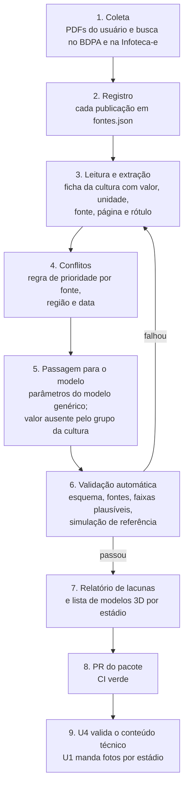

# 19 · Ingestão de cultura e novo pacote

**Estado:** rascunho · **Esforço:** `extra` (`MAPA_DO_PROJETO` §1.2)

## 1. Objetivo
Definir o fluxo pelo qual o agente lê um conjunto de publicações sobre uma cultura (exemplo: beterraba) e transforma o conteúdo num pacote validado que o simulador carrega sem código novo. O pacote cobre anatomia, estádios de crescimento, água, nutrição, temperatura, pragas, doenças, plantas daninhas, defensivos registrados, técnicas de irrigação e de manejo.

## 2. Escopo e limites
Dentro.
1. Coleta, registro e leitura das publicações.
2. Ficha estruturada da cultura, com valor, unidade, fonte, local e rótulo em cada campo.
3. Passagem da ficha para os parâmetros do modelo genérico de planta e do modelo de fitossanidade.
4. Regras para valor ausente e para valores que divergem entre fontes.
5. Validação automática e relatório de lacunas.
6. Lista de modelos 3D por estádio para a etapa de arte.

Fora.
1. Equações do modelo de planta e da base de clima e solo (documento 05 e `BASE_MODELOS` §3.0).
2. Esquema formal dos arquivos do pacote (documento 04). Este documento define o conteúdo e o fluxo, e o 04 define o formato.
3. Leitura de PDF dentro do jogo. O jogo funciona sem internet e sem modelo de linguagem; a leitura acontece no repositório, feita pelo agente, e o jogo só carrega o pacote pronto.

## 3. Fontes envolvidas

| ID da fonte | O que fornece aqui | Rótulo |
|---|---|---|
| FAO-1998-FAO56 | Grupos de culturas e tabelas de Kc, raiz e depleção usados quando a cultura não tem dado brasileiro | [FONTE:FAO-1998-FAO56] |
| JKI-2018-BBCH | Escala fenológica comum: geral (p. 14), beterraba (p. 46), alface (p. 111), tomate (p. 129); licença CC BY 4.0 | [FONTE:JKI-2018-BBCH] |
| MAPA-2026-AGROFIT | Produtos registrados por cultura, em dados abertos CC BY atualizados todo dia | [FONTE:MAPA-2026-AGROFIT] |
| Publicações da cultura | Todo valor da ficha | registradas no passo 2 do fluxo |

O Anexo I do manual do AquaCrop 7.3 traz parâmetros de 17 culturas, entre elas beterraba açucareira (p. 28) e tomate para indústria (p. 36), e não traz alface nem outras folhosas. O Anexo II dá durações indicativas dos estádios (p. 66) [FONTE:FAO-2026-AQUACROP73].

## 4. Dependências
Precisa de 04 (formato do pacote), 05 (parâmetros do modelo genérico), 10 (fitossanidade), 17 (arte por estádio) e 22 (cenários de referência da base de clima e solo). Alimenta 14 (pacote inicial) e todas as culturas novas.

## 5. Contratos e esquemas

### 5.1 Fluxo

1. **Coleta.** O usuário manda os PDFs ou pede a busca. O agente busca primeiro na Embrapa (`docs/referencias/FONTES.md` §5) e depois nas fontes complementares (`00_INDICE` §1.4). Os PDFs ficam em `docs/referencias/pdf/`, fora do Git.
2. **Registro.** Cada publicação lida entra no registro com URL, ano e licença. Publicação incompleta vai para a fila de verificação e não pode ser citada.
3. **Leitura e extração.** O agente preenche a ficha da cultura (§5.2). Cada valor leva unidade, ID da fonte, página ou tabela e rótulo. Texto didático (descrição de sintoma, recomendação) leva a mesma citação.
4. **Conflitos.** Quando fontes divergem, a ficha guarda todas as leituras com a região de cada uma. O pacote escolhe pela ordem Embrapa, depois outra fonte brasileira da mesma região, depois a mais recente, depois a estrangeira [INFERÊNCIA].
5. **Passagem para o modelo.** A ficha vira os parâmetros do modelo genérico de planta e de fitossanidade. Parâmetro sem fonte da cultura recebe o valor do grupo da cultura (folhosa, raiz, fruto, grão) com o rótulo [PROVISÓRIO] e a fonte do grupo. O pacote nunca fica com campo vazio sem aviso.
6. **Validação automática.** Esquema do documento 04; `tools/conferir_fontes.py`; faixas plausíveis por tipo de cultura; simulação de referência da cultura na base de clima e solo validada, comparando ciclo e produtividade com os valores das próprias publicações.
7. **Relatório de lacunas.** O que falta, o que é provisório, quais conflitos foram decididos e por quê. Ele vai no PR e no `BASE_MODELOS` §10 enquanto a cultura estiver em construção.
8. **PR.** O pacote entra só com CI verde.
9. **Validação humana.** U4 valida o conteúdo técnico. U1 manda fotos da planta em cada estádio para os modelos 3D (`CLAUDE.md` §6).

### 5.2 Ficha da cultura

| Bloco | Conteúdo | Usado por |
|---|---|---|
| Identidade | Nome científico, família, cultivares, tipo de cultura e órgão colhido | Modelo de planta; catálogo |
| Anatomia e estádios | Estádios na escala BBCH [FONTE:JKI-2018-BBCH] com descrição, duração em graus-dia e aparência | Fenologia; modelos 3D por estádio |
| Temperatura | Temperatura-base, ótima e máxima; estresses por calor e por frio | Fenologia; perda por temperatura |
| Água | Kc por estádio, profundidade de raiz, fração de depleção, Ky, tensão-limite, métodos de irrigação indicados | Balanço hídrico; irrigação |
| Crescimento | Cobertura máxima, ritmo de crescimento do dossel, produtividade da água, índice de colheita, RUE, coeficiente de extinção | Modelo de planta |
| Nutrição | Extração de nutrientes, recomendação de adubação por manual estadual, curva crítica de N, saturação por bases desejada | Química; laudo; recomendação |
| Pragas e doenças | Agente, sintomas, condições favoráveis, nível de controle, dano | Fitossanidade |
| Plantas daninhas | Espécies frequentes e período crítico de controle | Competição; janela de capina |
| Defensivos | Produtos registrados para a cultura no Agrofit, com ingrediente ativo, dose, intervalo de segurança e classe; meia-vida no solo. O arquivo do Agrofit muda todo dia, então a ficha guarda a data e o hash do retrato usado | Aplicação; ledger; degradação |
| Manejo | Espaçamento, densidade, época de plantio por região, ciclo, colheita | Operações; campanha |
| Referências | IDs das publicações usadas | Registro de fontes |

### 5.3 Garantias para qualquer cultura
1. A base de clima e solo não muda com a cultura. Ela foi validada sem cultura (`BASE_MODELOS` §3.0).
2. O modelo de planta é um só. O tipo de cultura escolhe o órgão colhido e a forma da partição. Nenhuma cultura tem código próprio.
3. Processo novo exigido por uma cultura (fixação biológica de N, tuberização) entra na base ou no modelo genérico e passa pela validação antes do pacote.

## 6. Decisões

| Decisão | Mecanismo / motivo | Alternativas descartadas | Origem |
|---|---|---|---|
| A leitura de PDF acontece no repositório, feita pelo agente; o jogo só carrega pacotes | O jogo roda sem internet no notebook. Ler e interpretar publicação exige um modelo de linguagem | Importador de PDF dentro do jogo | agente, decisão 50 |
| Ficha com citação por campo antes do pacote | Separa o que a fonte diz do que o modelo precisa e deixa a auditoria possível | Escrever direto nos parâmetros | agente [INFERÊNCIA] |
| Valor ausente pelo grupo da cultura, com [PROVISÓRIO] | O modelo roda e o relatório mostra o que falta | Bloquear a cultura até achar todos os dados | agente [INFERÊNCIA] |
| Simulação de referência compara ciclo e produtividade com as próprias publicações | Pega erro de unidade e de leitura que o esquema não pega | Só validação de esquema | agente [INFERÊNCIA] |

## 7. Exemplos
Piloto planejado com a beterraba no passo G9 do `MAPA_DO_PROJETO`, depois do tomate cereja.

## 8. Casos de teste
1. Ficha com um valor sem fonte → o validador recusa.
2. Duas fontes com Kc diferentes → a ficha guarda as duas e o pacote escolhe pela regra do passo 4, com a escolha no relatório.
3. Cultura sem produtividade da água publicada → o pacote usa o valor do grupo com [PROVISÓRIO] e o relatório lista a lacuna.
4. Ciclo simulado na referência fora da faixa publicada → o validador marca erro e o pacote não entra.
5. Defensivo sem registro no Agrofit para a cultura → o produto não aparece no jogo para aquela cultura.

## 9. Perguntas abertas
Nenhuma que bloqueie. O formato da ficha depende do documento 04.

## 10. Critérios de pronto
- [ ] Todas as seções preenchidas; nenhuma instrução do modelo restante.
- [ ] Formato da ficha fechado com o documento 04.
- [ ] Validador da ficha em `tools/` com testes.
- [ ] Piloto da beterraba concluído e relatório de lacunas publicado.
- [ ] Links internos válidos e fontes conferidas (CI).
