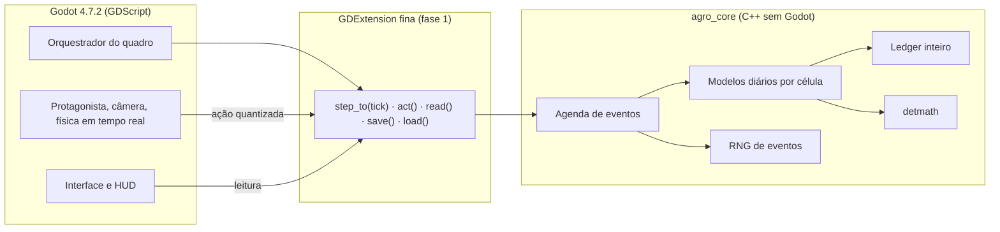

# Arquitetura de simulação

> Como o mundo calculado avança no tempo, conserva massa e dá o mesmo resultado em qualquer velocidade, em qualquer máquina e depois de salvar e carregar. O código que implementa esta arquitetura está em `engine/native/` (núcleo C++ sem dependência do Godot). Os documentos 02, 09 e 15 absorvem este texto na Etapa C do `MAPA_DO_PROJETO`.
> Rótulos: `[FONTE:ID]` · [MODELO] · [INFERÊNCIA] · [VERIFICAR] (`CLAUDE.md` §3, regra 7). Decisões: 16, 17, 27, 28, 36, 37, 39 a 42 do `DECISOES`.

## 1. Requisitos

| # | Requisito | O que ele exige da arquitetura |
|---|---|---|
| A1 | Mesmo mundo em 1x, 2x, 4x, 8x, 16x, 32x, dormir e depois de salvar e carregar | O passo dos modelos nunca muda. A velocidade só decide quanto tempo de jogo roda por quadro |
| A2 | Mesmo mundo no Linux do CI e no Windows do jogador | Nenhum resultado depende de biblioteca matemática da plataforma, de FMA ou da ordem de soma em ponto flutuante |
| A3 | Balanço exato de água, N, P, K, C e massa de solo | Estoques inteiros e transferências com o mesmo inteiro nos dois lados |
| A4 | Módulos que crescem por fase sem reescrita | Módulos não se conhecem. Eles falam com donos de recurso por interfaces fixas |
| A5 | Resposta imediata às ações do jogador | O tensiômetro reage à rega na hora, sem esperar o fim do dia |
| A6 | Aleatoriedade só em eventos de jogo | Modelos de processo determinísticos. Sorteio só em gerador de eventos com semente gravada |
| A7 | Custo dentro do notebook de referência | Passo diário barato e fatiável entre quadros |

## 2. Visão geral

1. **Godot** desenha, recebe a entrada e roda a física do protagonista e das máquinas em tempo real. Ele nunca calcula estado agronômico.
2. **agro_core** guarda todo o estado do mundo calculado e é a única coisa que o muda. Ele compila e roda nos testes sem o Godot.
3. **GDExtension** é a ponte. Ela expõe cinco chamadas e nada mais. A interface lê o estado por `read()` e muda o mundo só por `act()`.

## 3. Tempo

### 3.1 Uma agenda única de eventos
1. O mundo só muda quando um evento é processado. Todo evento tem a chave única (tick, fase, seq). O tick é o segundo de jogo em inteiro de 64 bits. A fase ordena classes de evento no mesmo segundo. O seq é um contador de inserção gravado no save.
2. As fases são, em ordem, passo diário (00:00), passo horário (a partir da fase 2), evento de mundo (laudo que chega, tempestade sorteada no modo semiaberto) e ação do jogador.
3. Como a chave é única, a ordem de processamento é total. Ela não depende do quadro, da velocidade, do dormir nem do ponto em que o save foi feito.
4. Processos periódicos são eventos que se reagendam. O passo diário de hoje agenda o de amanhã. Não há laços separados por camada de taxa. Laços separados deixariam indefinida a ordem entre camadas no mesmo instante.
5. O antigo "tick de mundo" de 1 a 5 minutos deixa de existir. Na fase 1 nenhum estado agronômico muda abaixo do dia, e eventos do jogador já têm resolução de 1 segundo.

### 3.2 Relógio, velocidade e dormir
1. Em 1x, 1 segundo real vale 24 segundos de jogo. O multiplicador (1, 2, 4, 8 e, na campanha, 16 e 32) multiplica esse avanço.
2. A cada quadro o relógio calcula até onde a agenda pode correr. A agenda processa os eventos devidos até esse ponto. O resto fracionário de tempo real é ritmo e não estado. Ele não entra no save.
3. Há um teto de tempo de jogo por quadro e um teto de eventos por quadro. No teto o jogo fica mais lento. O passo nunca muda. Isso evita a espiral da morte num notebook lento.
4. **Dormir** pula direto até a hora escolhida para acordar. **Pular até o próximo evento** pula até o próximo evento de interesse na agenda. Os dois usam o mesmo processamento de eventos.
5. Sol, céu e animação são funções puras do tempo contínuo interpolado. Eles não são estado e não precisam de passo.
6. O passo diário de muitas células pode ser fatiado em vários quadros. Enquanto ele não termina, a agenda segura os eventos posteriores à meia-noite. A interface mostra o dia anterior até o novo ficar pronto.

### 3.3 Física em tempo real
A física do Godot não é determinística entre taxas de quadro. Por isso ela fica fora do mundo calculado. O que entra no mundo é a ação quantizada e registrada. Uma passada de microtrator vira a lista de células tocadas, a carga e o número de passadas. O replay usa o registro, não a física.

## 4. Dentro do dia

### 4.1 Estado oficial e estado de leitura
1. **Estado oficial.** Os modelos validados (FAO-56, AquaCrop, CN) são diários [FONTE:FAO-1998-FAO56]. O estado oficial avança no passo diário e só nele.
2. **Ações do jogador** entram na hora em que acontecem como transferências do ledger. A água do regador sai da fonte e entra no compartimento "aplicada hoje" da célula. Nada some e nada espera.
3. **Estado de leitura.** Instrumentos e visual leem uma estimativa do momento, calculada como função pura do estado oficial da manhã, das transferências do dia e da fração do dia já passada [MODELO]. Ela não é gravada. Por isso não ameaça o determinismo.
4. No passo diário, o compartimento "aplicada hoje" entra no balanço como a irrigação do dia na equação do FAO-56. O modelo validado continua exato e o tensiômetro responde na hora.

### 4.2 Ordem causal na célula
O passo diário segue a ordem em que um processo produz o recurso que o próximo consome. A ordem é fixa e faz parte do contrato.

| # | Subsistema | Lê | Escreve |
|---|---|---|---|
| 1 | Astronomia (uma vez por propriedade) | latitude, dia do ano | declinação, fotoperíodo, radiação extraterrestre |
| 2 | Clima do dia | série INMET ou gerador de eventos | temperatura, radiação, umidade, vento, chuva |
| 3 | ET0 | clima do dia | ET0 |
| 4 | Árbitro de luz | cobertura e altura de cada espécie | fração interceptada por espécie |
| 5 | Demandas das plantas | estado de ontem, luz, ET0 | demanda de transpiração e de N |
| 6 | Água | chuva, aplicada hoje, ET0, demandas | escoamento, infiltração, drenagem, evaporação, transpiração alocada |
| 7 | Nitrogênio | drenagem, demandas | lixiviação, N alocado |
| 8 | Crescimento | luz, água e N alocados | biomassa, cobertura, raiz |
| 9 | Solo físico | preparo, tráfego, raízes, chuva | densidade, bioporos, rugosidade, ajuste do CN |
| 10 | Transferência lateral (fase 3) | escoamento das células | entrada de água vinda de montante |
| 11 | Fechamento | ledger | conferência exata e hash do dia |

1. É um *splitting* sequencial de primeira ordem. O erro de separar os processos tem a mesma ordem do erro de discretização diária que o FAO-56 e o AquaCrop já aceitam. Quem produz roda antes de quem consome. Só as realimentações lentas têm atraso de um dia, como a cobertura de ontem que afeta a evaporação de hoje.
2. Chuva e irrigação são pulsos. O pulso inteiro fica dentro do módulo de água. Nenhum pulso é dividido entre módulos [VERIFICAR na fonte primária: Gomes et al. 2018 e Linköping ECP 157].

### 4.3 Árbitros de recurso
1. Cada consumidor declara uma demanda. O dono do recurso decide quanto entrega. O consumidor cresce com o que recebeu. Só o dono debita o estoque. É o padrão do APSIM, em que os módulos de cultura falam com os módulos de recurso só pelo motor [VERIFICAR na fonte primária: Keating et al. 2003, §3.9].
2. Quando a oferta não cobre a soma das demandas, a divisão é feita em inteiros pelo método do maior resto. Cada espécie recebe o piso da cota proporcional. As poucas unidades que sobram vão para os maiores restos, com empate decidido pelo menor índice. A soma das partes é igual à oferta, sem erro de arredondamento (`engine/native/include/agro/allocate.hpp`).
3. Os pesos de cada demanda (sobreposição de raízes, estrato de altura) entram antes da divisão, na própria demanda. O árbitro não conhece espécie nenhuma.

## 5. Entre células

1. **Operador vertical.** Os processos 1 a 9 de uma célula leem só a própria célula e os forçantes do dia. As células são independentes nesse trecho. A ordem delas e o número de *threads* não mudam o resultado.
2. **Operador lateral (fase 3).** O escoamento que sai de uma célula entra na vizinha de jusante no mesmo dia. Esse operador é sequencial sobre um grafo acíclico. A ordem é topológica e fixa, por cota decrescente com empate pelo índice da célula. Planos e depressões recebem direção pelo algoritmo Priority-Flood [VERIFICAR: Barnes, Lehman e Mulla 2014]. Cada passagem é uma transferência inteira no ledger. Bacias independentes podem rodar em paralelo.
3. Reduções que somam valores de muitas células (balanço da propriedade, relatório) são feitas em inteiros ou em ordem fixa de índice. Soma em ponto flutuante não é associativa.

## 6. Conservação exata

1. Estoques ficam em contas inteiras de um ledger por grandeza (`engine/native/include/agro/ledger.hpp`). As unidades guardam volume ou massa por célula e não altura por área. Assim a transferência entre células de áreas diferentes continua exata.

| Grandeza | Unidade inteira | Equivalência | Menor fluxo diário de interesse |
|---|---|---|---|
| Água | mL | 1 mL em 1 m² = 1 µm de lâmina | 0,01 mm em 0,25 m² = 2,5 mL |
| N, P, K | µg | 1 kg/ha = 100 mg/m². Numa célula de 0,25 m² são 25 000 µg | 0,01 kg/ha em 0,25 m² = 250 µg |
| C | mg | 1 kg/ha = 100 mg/m² | 0,1 kg/ha em 0,25 m² = 2,5 mg |
| Massa de solo | g | 1 cm de solo com densidade 1,2 Mg/m³ em 1 m² = 12 000 g | 1 mm de erosão em 0,25 m² = 300 g |

2. Todo fluxo é calculado em ponto flutuante e convertido uma única vez para inteiro (`to_units`). A transferência tira o inteiro de uma conta e põe o mesmo inteiro em outra. A soma de inteiros é exata e associativa.
3. **Conta de compartimento** é estoque físico dentro do sistema. Ela nunca fica negativa. Uma transferência que a deixaria negativa é defeito de modelo e para a simulação.
4. **Conta de fronteira** é o mundo de fora (chuva, atmosfera, drenagem profunda, fora da propriedade, mercado, condição inicial). O saldo dela é o total trocado. É ele que responde no painel "para onde foi a minha água".
5. No fim de cada dia o ledger confere cada conta (saldo de abertura mais diário igual a saldo de fechamento) e confere que a soma de todas as contas é zero. Não há tolerância.

## 7. Determinismo

### 7.1 Mecanismo
1. O IEEE 754 exige arredondamento correto em soma, subtração, multiplicação, divisão e raiz quadrada. Uma sequência fixa dessas operações dá os mesmos bits em qualquer máquina x86-64.
2. Duas coisas quebram isso. A primeira é o compilador fundir a·b + c numa instrução FMA, que arredonda uma vez só. A segunda são as funções exp, log, sin, cos, atan e pow, que a norma não fixa bit a bit e que variam entre a glibc, a CRT do MinGW e a do MSVC.
3. Os binários oficiais do Godot são compilados com MinGW [FONTE:GODOT-2026-COMPWIN]. As funções matemáticas do GDScript dependem da biblioteca da plataforma [VERIFICAR no código do Godot]. Por isso nenhum estado é calculado em GDScript.
4. A abordagem do Box2D é a referência. Ele chegou ao determinismo entre plataformas evitando *fast-math* e FMA e escrevendo as próprias funções trigonométricas [FONTE:BOX2D-2024-DETERMINISM].

### 7.2 Regras do núcleo
1. Todo estado é calculado em C++ no `agro_core`, compilado com `-ffp-contract=off` e sem `-ffast-math`. O código recusa compilar com precisão estendida x87 (`FLT_EVAL_METHOD` diferente de zero).
2. As funções elementares vêm de `agro::detmath`, feitas só com as cinco operações exatas, em ordem fixa, a partir do fdlibm e do musl [MODELO]. A biblioteca CORE-MATH, com arredondamento correto, fica como alternativa se um dia for preciso [FONTE:INRIA-2026-COREMATH].
3. Erro medido contra precisão arbitrária de 120 bits (`tools/medir_erro_detmath.py`). Menos de 1 ulp em exp, log, sin, cos e atan. Menos de 2 ulp em tan, atan2 e acos. Em pow, menos de 2 + 0,8·|y| ulp.
4. O estado usa `double` de 64 bits. `float` de 32 bits fica só na renderização.
5. Nenhum modelo lê o tempo do quadro.

### 7.3 Evidência
| Configuração | Hash dos 56 000 vetores do detmath |
|---|---|
| g++ 13 -O2, g++ -O0, clang++ 18 -O2 | `41cbfb563eb7b91d` |
| g++ -O3 -march=haswell (FMA disponível) com `-ffp-contract=off` | `41cbfb563eb7b91d` |
| g++ -O2 -march=haswell sem `-ffp-contract=off` | `1631d7df988e7a71` (diferente) |
| MinGW g++ 14.2.0 no Windows Server 2022 (job do CI) | `41cbfb563eb7b91d` |

A terceira linha prova o mecanismo. Basta liberar a fusão em FMA para o resultado mudar. O teste `tests/test_determinism.cpp` roda um mundo de brinquedo com agenda, ledger, árbitro, detmath e um evento sorteado. Ele confere o mesmo hash diário em 1x, 8x, 32x com um evento por quadro, quadros irregulares, dormir e save e carga no meio.

## 8. Aleatoriedade só em eventos

1. Os modelos de processo são determinísticos e usam valor esperado. A emergência de daninhas sai do banco de sementes como densidade esperada. O risco de doença é um índice. Nenhum deles sorteia.
2. O sorteio existe só no gerador de eventos. Exemplos são o clima sintético e os surtos de praga do modo semiaberto e a quebra de máquina. Cada sorteio é função pura de (semente do mundo, stream, dia, célula, índice) (`engine/native/include/agro/rng.hpp`). Não há estado de gerador a salvar. Um stream nunca desloca outro. Pular dias não muda nada.
3. A campanha usa séries reais do INMET e não sorteia nada. O gerador climático entra só no modo semiaberto (fase 3).

## 9. Núcleo C++ e a ponte com o Godot

1. `engine/native/` contém o `agro_core`. Hoje ele tem agenda, relógio, ledger, alocação por maior resto, RNG de eventos, hash de estado e detmath, com testes. Os modelos entram nele a partir do passo B5 do `MAPA_DO_PROJETO`.
2. O estado fica em estrutura de arrays. Um vetor de `double` por variável e as contas do ledger em inteiros, com o mesmo índice de célula.
3. Na fase 1 a GDExtension (godot-cpp) embrulha o núcleo. Ela é compilada com MinGW-w64 no CI, com as mesmas flags. O GDScript só orquestra o quadro, desenha e chama a ponte.
4. Custo estimado de 0,3 a 3 µs por célula e dia em C++ [INFERÊNCIA]. Para 1000 células, de 0,3 a 3 ms por dia de jogo. A medida real entra no passo D1b.

## 10. Save, carga e replay

1. O save pode ser feito entre dois eventos quaisquer, desde que nenhum passo diário esteja em andamento.
2. O arquivo guarda cabeçalho (identificador, versão do esquema, versão do motor, hash do pacote), semente do mundo, tick, saldos do ledger, arrays de estado, agenda pendente com o contador seq, registro de ações e hash do último dia. O resto fracionário do relógio não entra.
3. Formato com manifesto JSON e bloco binário. Migração por cadeia `migrar_vN_para_vN+1`, com teste que carrega um save antigo, avança 30 dias e compara o hash.
4. O replay reaplica o registro de ações sobre o estado inicial e precisa reproduzir todos os hashes diários.

## 11. Testes que sustentam a arquitetura

| Teste | Onde | O que prova |
|---|---|---|
| Unidades do núcleo | `engine/native/tests/test_core.cpp` | RNG, alocação exata, ledger, ordem da agenda, relógio, detmath |
| Determinismo do tempo | `engine/native/tests/test_determinism.cpp` | 1x = 8x = 32x = quadros irregulares = dormir = save e carga |
| Vetores do detmath | `engine/native/tools/detmath_vectors.cpp` e `golden/` | Mesmo hash em vários compiladores, otimizações e no Windows |
| Erro em ulp | `tools/medir_erro_detmath.py` | Precisão contra 120 bits |
| CI | `.github/workflows/ci.yml` | Jobs Linux e Windows a cada PR |

Próximos testes. Exemplos numéricos do FAO-56 para astronomia e ET0 (passo B5). Fechamento do ledger com sequências aleatórias de ações em cada módulo. Reprodução da hipérbole de Cousens e da faixa de Ky da alface como testes de validação.

## 12. Pontos a verificar na fonte primária
Gomes et al. 2018 e ECP 157 sobre mestres de passo fixo e sinais descontínuos. Keating et al. 2003 e o SoilArbitrator e o MicroClimate do APSIM. Priority-Flood. Funções matemáticas do GDScript. Exemplos do FAO-56 e do TR-55. Todos estão na rodada 4 de pesquisa (passo B0.5).
