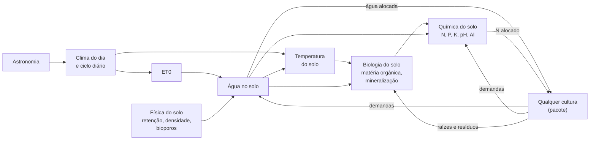

# Base de modelos do simulador

> Documento-base da Fase 0. Ele guarda a escolha dos modelos e os dados levantados em três rodadas de pesquisa. A arquitetura de simulação está em `ARQUITETURA_SIMULACAO.md`. Na Etapa C do `MAPA_DO_PROJETO` o conteúdo passa para os documentos 04, 05, 09 e 14 e este arquivo sai do repositório.
> Número com `[FONTE:ID]` está no registro de fontes. Número sem ID vem de publicação que está na fila de verificação do registro (`docs/referencias/fontes.json`). Ele só entra no pacote depois de registrado, com ID e local.
> Equações vêm de manuais técnicos, livros e artigos. Dados vêm da Embrapa e de órgãos brasileiros. Parâmetro estrangeiro leva o rótulo [PROVISÓRIO].

## 1. Critérios e matriz de decisão

O usuário fixou sete critérios. Cada modelo candidato é avaliado contra todos.

| # | Critério | Por que importa |
|---|---|---|
| C1 | Baixa complexidade inicial | A fatia vertical precisa sair inteira antes de qualquer refinamento |
| C2 | Escalabilidade | O modelo precisa trocar estado com modelos de fases posteriores sem reescrita |
| C3 | Parâmetros publicados ou mensuráveis pela Embrapa ou por órgão brasileiro | Regra de fonte do projeto (`00_INDICE` §1.4) |
| C4 | Cobertura de vários cultivos | Cultura nova deve ser só dado novo |
| C5 | Estabilidade quando vários modelos interagem | O acoplamento não pode divergir nem depender da velocidade do relógio |
| C6 | Poder explicativo biológico | Um mesmo modelo deve explicar vários fenômenos do cultivo |
| C7 | Documentação aberta | O agente precisa ler as equações para implementar e testar |

O simulador pode revelar fenômenos difíceis de ver no campo. Por isso o modelo precisa ser causal. Bônus fixo de produtividade não explica nada e fica fora.

Nota de 1 a 5 (5 é o melhor). O traço indica critério que não se aplica.

| Domínio e candidato | C1 | C2 | C3 | C4 | C5 | C6 | C7 | Escolha |
|---|---|---|---|---|---|---|---|---|
| Agenda única de eventos, *splitting* sequencial, árbitro de recurso e ledger inteiro | 4 | 5 | – | 5 | 5 | – | 5 | Fase 1 |
| Splitting de Strang | 2 | 3 | – | 4 | 4 | – | 5 | Descartado |
| Waveform relaxation | 1 | 3 | – | 4 | 5 | – | 4 | Descartado |
| Água por *bucket* FAO-56 com Curve Number | 5 | 4 | 4 | 5 | 5 | 2 | 5 | Fase 1 |
| Água em várias camadas (cascata) | 4 | 5 | 4 | 5 | 5 | 3 | 5 | Fase 2 |
| Equação de Richards | 1 | 4 | 3 | 5 | 2 | 4 | 5 | Fase 4 opcional |
| Planta AquaCrop simplificado (água) | 4 | 3 | 3 | 4 | 5 | 3 | 5 | Fase 1 |
| Planta por luz (RUE, tipo LINTUL) | 3 | 4 | 2 | 4 | 4 | 4 | 5 | Descartado |
| Planta híbrida, mínimo entre luz e água | 3 | 5 | 3 | 5 | 4 | 5 | 5 | Fase 2 |
| Daninha logística com Cousens | 5 | 2 | 2 | 2 | 5 | 1 | 4 | Fase 1 |
| Daninha com o mesmo código da planta | 3 | 5 | 2 | 5 | 4 | 5 | 4 | Fase 2 |
| Solo físico com Ds, bioporos e rugosidade | 3 | 5 | 4 | 5 | 4 | 4 | 4 | Fase 3 |
| Compactação completa (Söhne, SoilFlex) | 1 | 3 | 2 | 5 | 3 | 4 | 4 | Descartado |
| Química por inventário, pH–V e cinética do calcário | 4 | 4 | 5 | 5 | 5 | 3 | 5 | Fase 2 |
| Troca de Gapon e salinidade | 3 | 4 | 3 | 5 | 4 | 4 | 5 | Fase 3 |
| Húmus em dois compartimentos | 4 | 4 | 3 | 5 | 5 | 3 | 4 | Fase 3 |
| RothC ou CENTURY | 2 | 4 | 3 | 5 | 4 | 4 | 5 | Fase 4 |
| Especiação com PHREEQC em tempo real | 1 | 2 | 2 | 5 | 1 | 5 | 5 | Descartado |
| Clima por série real do INMET | 5 | 5 | 5 | 5 | 5 | – | 5 | Fase 1 |
| Gerador ClimaBR (Markov de 1ª ordem) | 4 | 5 | 5 | 5 | 5 | – | 4 | Referência de validação |
| Markov com exponencial mista | 3 | 5 | 4 | 5 | 5 | – | 4 | Fase 3 (modo semiaberto) |
| Encosta por CN, MUSLE e D8 em cascata | 4 | 5 | 4 | 5 | 5 | 3 | 5 | Fase 3 |
| Onda cinemática e *virtual pipes* | 2 | 3 | 2 | 5 | 2 | 3 | 4 | Fase 4 só visual |

## 2. Arquitetura de simulação

Agenda de eventos, relógio, ordem causal, árbitros, ledger, determinismo, núcleo C++, save e replay estão em `ARQUITETURA_SIMULACAO.md`.

## 3. Modelos por fase

### 3.0 Base de clima e solo

1. Clima e solo são a base do simulador. Eles não conhecem nenhuma cultura. A cultura só declara demandas de água, nitrogênio e luz e devolve raízes, resíduos e cobertura ao solo (`ARQUITETURA_SIMULACAO` §4.3). Por isso a base validada sem cultura continua válida para toda cultura nova.
2. A base precisa reproduzir solos e climas reais do Brasil. Ela é validada contra dados observados em cenários de referência sem cultura antes de receber culturas novas (Etapa V do `MAPA_DO_PROJETO`). É essa validação que permite tirar resultados do simulador sem ter uma propriedade.

| Componente | O que calcula | Fase | Validado contra |
|---|---|---|---|
| Astronomia | Fotoperíodo, radiação extraterrestre e posição do sol | 1 | Exemplos numéricos do FAO-56 [FONTE:FAO-1998-FAO56] |
| Clima diário | Grade diária BR-DWGD para qualquer município [FONTE:IJOC-2022-XAVIER]; gerador só no modo semiaberto | 1 (série), 3 (gerador) | Estações do INMET; estatísticas de chuva mensal, dias com chuva e veranicos |
| Ciclo diário | Temperatura e umidade hora a hora | 1 (leitura e visual), 2 (processos horários) | Série horária de estação automática do INMET |
| ET0 | Penman–Monteith, com Hargreaves–Samani calibrado de reserva | 1 | Exemplos do FAO-56 e ET0 calculada com dados de estação |
| Água no solo | Uma camada na fase 1, camadas em cascata e evaporação em dois estágios na fase 2 [FONTE:APSIM-2020-SOILWAT] | 1 e 2 | Umidade diária em solo nu no semiárido [FONTE:AGRARIA-2015-SILVA]; outras regiões a levantar |
| Temperatura do solo | Temperatura por camada a partir do ar, da chuva e da radiação, no estilo do APSIM-soiltemp [FONTE:AJEA-2007-CHAUHAN] | 1 | Medidas de temperatura do solo no Brasil (a levantar) |
| Física | Densidade, porosidade, curva de retenção, compactação e bioporos | 1 a 3 | [FONTE:VZJ-2018-HYBRAS]; [FONTE:RBCS-2008-NICOLOSO] |
| Química | CTC, bases, alumínio, pH–V, calcário, P, K e salinidade | 1 a 3 | Curvas de incubação de calcário; relação pH–V (§4.1) |
| Biologia | Matéria orgânica em compartimentos, mineralização e imobilização de N, respiração e bioporos | 2 e 3 | Incubações de mineralização de N em solos brasileiros (a levantar) |

3. **Cenários de referência.** Solo nu em pousio em cinco regiões climáticas (semiárido, Cerrado, Sudeste, Sul e Amazônia), com séries reais. O núcleo roda o cenário por linha de comando, sem o jogo, e compara cada variável com o dado observado. As métricas são as do documento da Embrapa Cerrados (viés médio, raiz do erro quadrático médio, eficiência, índice d de Willmott e índice c = r·d) [FONTE:EMB-CPAC-2021-DOC381]. Os limites de aceite ficam no documento 22 [INFERÊNCIA]. O APSIM foi testado do mesmo jeito, simulando água e nitrato em pousio [FONTE:AGSY-1998-PROBERT].
4. **Cultura nova não muda a base.** Se uma cultura exigir um processo novo do solo, como a fixação biológica de N por leguminosa, o processo entra na base e passa pela validação antes da cultura.

### 3.1 Fase 1 (canteiro plano de alface)

| Módulo | Modelo | Mecanismo | Referência a registrar |
|---|---|---|---|
| Astronomia | Declinação, fotoperíodo e radiação extraterrestre do FAO-56 | Expressões fechadas para qualquer latitude do Brasil | FAO-56 cap. 3 |
| Clima | Série real de estação automática do INMET e curva diurna de temperatura | Auditável contra a fonte e sem calibração estatística | INMET; Parton e Logan |
| ET0 | Penman–Monteith com Hargreaves–Samani de reserva | Balanço de energia mais demanda aerodinâmica | FAO-56 |
| Temperatura do solo | Temperatura por camada a partir do ar, da chuva e da radiação, no estilo do APSIM-soiltemp | Condução de calor amortecida com a profundidade | [FONTE:AJEA-2007-CHAUHAN] |
| Água | *Bucket* de uma camada, Kc simples, Ks e escoamento por CN (no núcleo, `water.hpp`) | Tanque com ladrão que conserva massa a cada passo | [FONTE:FAO-1998-FAO56] cap. 8; [FONTE:NRCS-2004-NEH630-CH10] |
| Solo físico | Capacidade de campo, ponto de murcha e densidade por classe e textura | Tabela com fonte e curva de retenção (§4.6) | Embrapa; SiBCS |
| Química | Laudo com V% e CTC, calagem por saturação por bases, NPK por formulação, nitrogênio mineral com lixiviação | Inventário e um compartimento dinâmico de nitrato | Embrapa Hortaliças; manuais estaduais |
| Planta | Modelo genérico por tipo de cultura (folhosa, raiz, fruto, grão) no estilo do AquaCrop, com graus-dia, cobertura, transpiração, produtividade da água e índice de colheita | Biomassa proporcional à transpiração normalizada pela ET0; o tipo define o órgão colhido | FAO AquaCrop |
| Daninhas | Coorte com cobertura logística e perda de Cousens, janela de capina pelo período crítico (§4.8) | Competição com dano marginal decrescente | Cousens 1985; [FONTE:SEMINA-2010-GIANCOTTI] |
| Irrigação | Regador, gotejo com eficiência e fração de área molhada, tensiômetro virtual (gatilho de 15 kPa a 10 cm, §4.3) | Lâmina pela ETc e manejo pela tensão da água | Embrapa Hortaliças |
| Arquitetura | Agenda única, ledger inteiro, árbitros, núcleo C++ com detmath | `ARQUITETURA_SIMULACAO` | APSIM; [FONTE:BOX2D-2024-DETERMINISM] |
| Relatório | Atribuição da perda aos fatores Ks, nitrogênio, daninha e V% | Cada fator multiplicativo é registrado por dia | [INFERÊNCIA] |

A interface de planta já nasce preparada para o árbitro de luz da fase 2. A alface é a cultura da fatia porque o índice de colheita da alface é alto e quase constante. Isso dispensa florescimento e partição para frutos. O modelo de planta é um só para todas as culturas. Uma cultura nova entra só com parâmetros, preenchidos pelo fluxo de ingestão do documento 19, e os estádios seguem uma escala fenológica comum (BBCH [VERIFICAR]).

### 3.2 Fase 2 (horta completa e campanha em área plana)
1. Água em várias camadas por cascata.
2. Planta híbrida com biomassa igual ao mínimo entre a limitada por luz e a limitada por água (§7), com árbitro de luz.
3. Daninhas com o mesmo código da planta e parâmetros próprios.
4. Calcário com cinética por classe granulométrica, relação pH–V e NPK por formulação (§4.1 e §6).
5. Biologia do solo com matéria orgânica em compartimentos (resíduo fresco, biomassa microbiana e húmus), mineralização e imobilização de N dependentes da temperatura e da umidade do solo. A referência é o SoilN do APSIM, reimplementado a partir dos artigos [FONTE:AGSY-1998-PROBERT], sem copiar código (decisão 55).
6. Séries do INMET de vários anos e de estações de todas as regiões. A campanha não usa gerador climático, porque a aleatoriedade fica só nos eventos do modo semiaberto (decisão 40).
7. Densidade do solo simples por preparo e tráfego, malha de canteiro de 5 cm, deformação do terreno e Terrain3D 1.1.x na propriedade (§8).
8. Defensivos com dose e carência do Agrofit e meia-vida provisória com correção de temperatura e umidade (§4.2).
9. Compostagem, palhada com Kc dual, aspersão com molhamento foliar (passo horário), microtrator e tomate cereja.

### 3.3 Fase 3 (encosta, solo vivo e modo semiaberto)
1. Roteamento D8 em cascata, MUSLE e práticas conservacionistas (§8).
2. Solo físico com resistência à penetração, IHO e bioporos, e plantas de cobertura (§5).
3. Troca de Gapon e salinidade, fósforo em dois compartimentos e húmus em dois compartimentos (§6).
4. Consórcio por partição de luz, banco de sementes de daninhas, tempo hidrotérmico.
5. Gerador climático do modo semiaberto. Markov de primeira ordem com quantidades em exponencial mista, validado contra o ClimaBR nas mesmas estações.
6. ZARC na escolha da época de plantio.

### 3.4 Fases 4 e 5
Fase 4 reúne economia, combustível, NPCs, cidades, gases e deriva, micronutrientes por tabelas de especiação geradas offline, RothC, epidemiologia espacial e água visual por *virtual pipes*. Fase 5 reúne os animais, que reaproveitam o ledger de N e C, o árbitro de recurso (pastejo como consumidor) e a compactação por pisoteio.

## 4. Dados levantados

Valores das rodadas 2 e 3 de pesquisa. Os que têm `[FONTE:ID]` estão no registro. Os demais vêm de publicações da fila de verificação e entram no pacote só depois de registrados.

### 4.1 Calcário
1. **Reatividade legal (MAPA).** RE é o percentual que reage em 3 meses. RE = 0,2·F(10–20) + 0,6·F(20–50) + 1,0·F(<50), com partículas retidas na peneira 10 valendo zero. PRNT = PN·RE/100 (Boletim Técnico 6; RBCS 39, 2015).
2. **Cinética observada (Embrapa).** Depois de 6 meses de contato a reação é quase completa (p. 63) e depois de 3 meses mais de 60% do calcário mais fino já reagiu (p. 64). Sem água no solo a incorporação tem pouco efeito (p. 64). O PRNT mínimo recomendado é 80% (p. 65) [FONTE:EMB-CNPAF-2014-CALAGEM].
3. **Formulação adotada.** Cada classe granulométrica j segue dM_j/dt = −k_j·f(θ)·M_j. A dissolução do CaCO₃ exige H⁺ em solução. Por isso f(θ) vale zero abaixo do ponto de murcha e cresce linearmente até 1 na capacidade de campo. Para a classe fina, 1 − e^(−90k) ≈ 0,62 dá k ≈ 0,0107 por dia e 87% em 180 dias. Essa calibração é provisória.
4. **pH e V%.** pH em água = 4,50 + 0,025·V, relação atribuída a Raij, Cantarella e Zullo (1979) e chamada de modelo teórico por Guarçoni [FONTE:COFFEESCI-2017-GUARCONI]. O resumo do artigo de 1979 diz que o critério pH–saturação por bases dá necessidades de calagem muito baixas [FONTE:BRAGANTIA-1979-RAIJ]. A página da equação ainda não foi conferida no PDF. Vale para solos de São Paulo. O pacote guarda o par (a, b) por classe de solo.
5. Não há equação publicada para pH em CaCl₂. A relação 4,1 + 0,025·V é derivação própria e provisória.

### 4.2 Meia-vida de defensivos
1. A Embrapa tem banco parcial (Circular Técnica 48, Produção Integrada de Maçãs). O IBAMA publica perfis ambientais com DT50, mas vários valores estão tarjados por proteção de dados. O Agrofit traz registro, doses e carência e não traz DT50 de forma sistemática.
2. Não há base brasileira aberta e completa. O banco PPDB (Universidade de Hertfordshire) entra como **provisório**, com campo de origem, para ser trocado por valores do IBAMA ou de estudos brasileiros.
3. Decaimento M(t) = M0·exp(−ln2·t/DT50), com DT50 corrigida pela temperatura e pela umidade do solo. Solo tropical quente degrada mais rápido que a medida de laboratório a 20 °C.
4. **Correções confirmadas.** Q10 = 2,58, equivalente a energia de ativação de 65,4 kJ/mol, e correção de umidade de Walker f = (θ/θ_ref)^B com B = 0,7 [FONTE:JRC-2021-FOCUSGW]. A origem do Q10 = 2,58 é a EFSA [FONTE:EFSA-2017-PECSOIL].
5. Nenhum DT50 medido no Brasil foi encontrado até a rodada 3.

### 4.3 Alface

| Parâmetro | Valor | Fonte e situação |
|---|---|---|
| Kc inicial, médio, final | 0,70, 1,05 e 0,95 | [FONTE:EMB-CNPH-2011-CAP5] Tabela 9, p. 194 |
| Fração de área molhada | 0,95 para hortaliças de menor espaçamento | [FONTE:EMB-CNPH-2011-CAP5] p. 183 |
| Fração de depleção p | 0,30, ajustada pela ETc | [FONTE:FAO-1998-FAO56] tabela 22 |
| Profundidade de raiz | 0,25 m em canteiro | apostila UFAC e Embrapa; [INFERÊNCIA] |
| Gatilho de irrigação | Faixa de 10 a 20 kPa em aspersão e gotejo; 15 kPa no tensiômetro raso a 10 cm; 25 kPa em sulco | [FONTE:EMB-CNPH-2008-CT57] Tabela 1 e p. 12; [FONTE:EMB-CNPH-2009-CT69] Tabela 1, p. 7 |
| Temperatura-base | 6 °C da germinação ao transplante e 10 °C do transplante à colheita | [FONTE:BRAGANTIA-1976-BRUNINI] resumo |
| Temperatura superior | 30 °C | [FONTE:INTECH-2020-AMIROUCHE] Tabela 1; [PROVISÓRIO] |
| Soma térmica | 898 °C·dia em 45 dias (Simpson, Grand Rapids) e 1050 °C·dia em 52 dias (Bruna, Palmas), Bom Jesus, PI | [FONTE:RBMET-2019-FERNANDES] Tabela 2 |
| Resposta à temperatura | desenvolvimento máximo perto de 22 °C e menor acima | [FONTE:BRAGANTIA-1976-BRUNINI] resumo. Exige função com teto |
| Espaçamento | 0,25 × 0,25 m | Embrapa Hortaliças, livro de cultivares (a registrar) |
| Ciclo | 35 dias no calor e 45 dias nos demais (BRS Mediterrânea) | Embrapa Hortaliças, livro de cultivares (a registrar) |
| Produtividade da água WP* | 15 g/m² (19 g/m² como limite superior) | [FONTE:MDPI-2018-KET]; [FONTE:MDPI-2026-ZHAI]; [FONTE:INTECH-2020-AMIROUCHE]; [PROVISÓRIO] |
| Cobertura máxima CCx | 81% | [FONTE:INTECH-2020-AMIROUCHE] Tabela 1; [PROVISÓRIO] |
| Cobertura inicial CC0 | densidade de plantas vezes área da muda | regra do AquaCrop [MODELO] |
| Crescimento e declínio do dossel CGC, CDC | 14,3 e 8,0% por dia | [FONTE:INTECH-2020-AMIROUCHE] Tabela 1; [PROVISÓRIO] |
| Estresse na expansão e nos estômatos | p_exp 0,25 a 0,55, p_sto 0,50, forma 3 | [FONTE:INTECH-2020-AMIROUCHE] Tabela 1; [PROVISÓRIO] |
| Índice de colheita de referência HIo | 95% | [FONTE:INTECH-2020-AMIROUCHE] Tabela 1; [PROVISÓRIO] |
| Curva crítica de N | %Nc = 4,56·DW^−0,357 (DW em t/ha de massa seca; válida de 0,9 a 3,4 t/ha). Alternativa espanhola %Nc = 3,39·DMP^−0,22 | [FONTE:ISHS-2003-TEI]; [FONTE:AAB-2025-SUAREZREY]; [PROVISÓRIO] |
| Eficiência de uso da radiação RUE | 1,44 g/MJ de radiação total interceptada, até 40 dias após a emergência | [FONTE:ANNBOT-1996-TEI]; [PROVISÓRIO] |
| Coeficiente de extinção k | 0,60 | [FONTE:ANNBOT-1996-TEI] com pendência (0,60 ou 0,655); [PROVISÓRIO] |
| Ky | não é parâmetro. Teste de validação com valor central 1,17 (lisímetro) e faixa de 0,9 a 1,4; valores publicados de 0,69 a 2,26 | [FONTE:ISHS-2022-ROUPHAEL]; [FONTE:SJAR-2008-KUSLU]; nenhum estudo brasileiro |

1. Não há calibração brasileira do AquaCrop para alface. A alface não consta do catálogo do AquaCrop [FONTE:MDPI-2018-KET].
2. O KcTr,x de 0,85 do capítulo IntechOpen é menor que o Kc médio de 1,05 de Marouelli. O pacote deriva o KcTr,x do Kcb do FAO-56 e guarda 0,85 só como teste [INFERÊNCIA].
3. Na fase 1 o Ky não entra no cálculo, porque a resposta ao déficit emerge do Ks e do WP*. O teste de validação exige que a inclinação entre perda relativa de produção e déficit relativo de ET fique entre 0,9 e 1,4, perto do valor de lisímetro de 1,17 [INFERÊNCIA].
4. **Conflito de tensão.** O capítulo de manejo da Embrapa lista alface com 20 a 50 kPa em aspersão, citando Sammis (1980) [FONTE:EMB-CNPH-2011-CAP5]. As Circulares 57 e 69, mais recentes e específicas para hortaliças, indicam 10 a 20 kPa e 15 kPa. O pacote usa as circulares.
5. **Conflito de temperatura-base.** Fernandes et al. usaram 8 °C até o transplante citando Brunini [FONTE:RBMET-2019-FERNANDES], mas o resumo de Brunini dá 6 °C [FONTE:BRAGANTIA-1976-BRUNINI]. O pacote usa o valor da fonte primária.
6. **Manejo prático.** Cartilha da Embrapa Amapá manda irrigar a alface quando a média dos tensiômetros passar de 20 kPa e parar quando o de 10 cm marcar 5 a 10 kPa [FONTE:EMB-CPAFAP-2011-TENSIOM]. Ela serve de regra didática da campanha.
7. Um valor de 410 °C·dia atribuído a Brunini em relatório português não foi verificado e não deve ser usado.

### 4.4 Curve Number
O escoamento diário segue o método do NRCS. S = 25400/CN − 254 em mm, Ia = 0,2·S e Q = (P − Ia)²/(P − Ia + S) quando P passa de Ia (Eq. 10-9, 10-10 e 10-13) [FONTE:NRCS-2004-NEH630-CH10]. O núcleo aplica o CN só à chuva, porque a Eq. 85 do FAO-56 desconta o escoamento só da precipitação [FONTE:FAO-1998-FAO56]. A perda por escoamento da água aplicada vem da eficiência do método de irrigação (§4.5).

Sartori, Lombardi Neto e Genovez classificam os solos brasileiros nos grupos hidrológicos A a D (Tabela 4) e aplicam o método numa microbacia com CN de 80,9 [FONTE:RBRH-2005-SARTORI1] [FONTE:RBRH-2005-SARTORI2]. Não há CN brasileiro para canteiro. Usar "culturas em linha" do TR-55 ajustado pelo grupo de Sartori, como [PROVISÓRIO].

O SoilWat do APSIM parte de um CN de solo nu, reduz o CN pela cobertura e pelo preparo (cn_red) e desfaz a redução do preparo com a chuva acumulada (cn_rain) [FONTE:APSIM-2020-SOILWAT]. A mesma documentação descreve a evaporação de Ritchie em dois estágios (U e CONA; exemplo U = 6 mm e CONA = 3,5) e a drenagem em cascata SWCON·(SW − DUL), adotadas como referência da fase 2. O código do APSIM não entra no projeto. Só as equações publicadas são reimplementadas (decisão 55).

### 4.5 Eficiência de irrigação

| Método | Faixa publicada | Fonte | Padrão do pacote |
|---|---|---|---|
| Gotejamento | 80 a 95% | [FONTE:EMB-CNPH-2011-CT98] p. 7 | 0,90 |
| Superfície (sulco) | 40 a 70% | [FONTE:EMB-CNPH-2011-CT98] p. 7 | 0,60 |
| Aspersão e microaspersão | Tabela 1 da Circular 98, ainda não transcrita | [FONTE:EMB-CNPH-2011-CT98] p. 8 | pendente |
| Regador | sem fonte | nenhuma | 0,85 [INFERÊNCIA] |

A perda (1 menos a eficiência) é particionada em deriva e evaporação, percolação e escoamento. Assim ela fecha o ledger e alimenta a drenagem e a lixiviação de nitrogênio.

### 4.6 Capacidade de campo
A literatura brasileira de IHO usa a capacidade de campo a −10 kPa. Solos arenosos usam −6 kPa. O valor de −33 kPa é convenção norte-americana e subestima a capacidade em Latossolos. O pacote guarda os pontos da curva de retenção (−6, −10, −33, −100 e −1500 kPa) ou os parâmetros de van Genuchten, mais um campo `fc_potential_kPa` por classe (padrão −10, e −6 se a areia passar de 70%). O motor calcula θCC pela curva e nunca lê número solto.

A base HYBRAS reúne 445 perfis e 1075 amostras de solos brasileiros com parâmetros de van Genuchten e funções de pedotransferência brasileiras [FONTE:VZJ-2018-HYBRAS]. Ela é a fonte padrão da curva de retenção por classe e textura. Trabalho derivado mostra que a sucção da capacidade de campo medida no campo depende da textura e da gênese do solo. O valor fixo de −10 kPa é uma simplificação operacional [MODELO]. O uso de −6 kPa em solo arenoso ainda não tem fonte primária.

### 4.7 Clima
**Forçante padrão.** A grade diária BR-DWGD v3.2.4 cobre todo o Brasil em 0,1° de 1961 a 2025, com chuva, temperaturas, radiação, umidade, vento e ETo, e tem séries por município [FONTE:IJOC-2022-XAVIER]. Ela é a série padrão de qualquer município na campanha e na Etapa V. O núcleo recalcula a ET0 do FAO-56 a partir das variáveis da grade e compara com a ETo da grade como teste. A grade é interpolada das estações do INMET e dos pluviômetros da ANA, então a comparação com essas estações mede só a perda por interpolação [MODELO].

**Gerador do modo semiaberto.** O ClimaBR usa cadeia de Markov e só dados pluviométricos [FONTE:RBEAA-2005-OLIVEIRA]. Para o semiárido a recomendação é Markov de primeira ordem com quantidades em exponencial mista (Wilks 1998), que captura melhor a cauda de eventos grandes que gera escoamento e erosão. O teste de aceitação é o comprimento dos veranicos. Ordem maior só entra se esse teste falhar. Parâmetros por estação do INMET e por mês. O gerador só roda no modo semiaberto (decisão 40).

### 4.8 Plantas daninhas na alface
1. Com 5% de perda tolerada, o período total de prevenção da interferência na alface Solaris foi de 21 dias após o transplante. A convivência no ciclo todo reduziu a produtividade em 25% [FONTE:SEMINA-2010-GIANCOTTI].
2. Espécies dominantes no mesmo trabalho. *Bidens pilosa*, *Amaranthus hybridus*, *Oxalis corniculata*, *Euphorbia heterophylla*, *Commelina benghalensis* e *Lepidium virginicum* [FONTE:SEMINA-2010-GIANCOTTI].
3. Em três cultivares, o período anterior à interferência foi de 1 a 3 dias, o período total de prevenção de 35 a 37 dias e o período crítico de 2 a 37 dias (Elisa), 3 a 37 dias (Lucy Brown) e 3 a 35 dias (Solaris) após o transplante. A convivência total reduziu a produtividade em 48, 40 e 33% [FONTE:HB-2023-DARIVA].
4. A janela de controle do jogo começa logo depois do transplante e vai até 35 a 37 dias, conforme a cultivar. O relatório de safra explica a perda quando o controle cai fora dela [INFERÊNCIA].
5. Os parâmetros I e A de Cousens para alface e os parâmetros de crescimento das daninhas não foram encontrados.

### 4.9 Erosão
1. **Fator topográfico.** LS = 0,00984·L^0,63·S^1,18, com L em metros e S em porcentagem, de Bertoni e Lombardi Neto (1999), para relevo suave ondulado a ondulado (Equação 5, p. 157) [FONTE:CCT-2015-NAKAO].
2. **Fator P.** Vale 1 sem prática conservacionista (p. 158). Plantio em contorno vale 0,50, 0,50, 0,60 e 0,70 e plantio em contorno com cordão vegetado vale 0,35, 0,35, 0,45 e 0,55 para declives de 2, 5, 10 e 15% (Tabela 2, p. 160) [FONTE:CCT-2015-NAKAO].
3. **Fator C.** Vai de 0 (solo protegido) a 1 (solo exposto) (p. 158) [FONTE:CCT-2015-NAKAO]. Valores de C para hortaliças e K por classe de solo ainda não foram transcritos.
4. **MUSLE.** Y = 11,8·(Q·qp)^0,56·K·C·P·LS, com Y em t, Q em m³ e qp em m³/s (Williams 1975, reapresentada em [FONTE:JRM-1984-SMITH]).

## 5. Solo físico e descompactação biológica

Estados por camada. Densidade Ds, fração de bioporos contínuos fbio e rugosidade RR. Todos ficam em vetores de `double` do núcleo C++.

1. **Resistência à penetração.** RP = a·θ^b·Ds^c (forma de Busscher). RP sobe quando o solo seca e quando compacta. Por isso um veranico endurece o solo compactado. Num Latossolo Roxo sob plantio direto, RP = 0,0361·Ds^7,9683·θ^−2,2940, com RP em MPa, Ds em Mg/m³ e θ em m³/m³ (Equação 1, p. 577) [FONTE:RBCS-1998-TORMENA]. Num Latossolo Vermelho distrófico sob integração lavoura-pecuária, RP = e·θ^f·Ds^5,6262 com e e f iguais a 0,0123 e −1,2762 (0 a 0,10 m), 0,0049 e −1,8467 (0,10 a 0,20 m) e 0,0019 e −2,4172 (0,20 a 0,30 m) (Quadro 3) [FONTE:RBCS-2013-FIDALSKI]. O pacote guarda os coeficientes por classe de solo e camada.
2. **IHO.** Limite superior igual ao menor entre θCC e o θ com 10% de ar. Limite inferior igual ao maior entre θPMP e o θ em que RP chega ao valor crítico. Tormena et al. usaram RP de 2,0 MPa, CC a −0,01 MPa e PMP a −1,5 MPa [FONTE:RBCS-1998-TORMENA]. Fidalski et al. usaram RP de 2,5 MPa e CC a −80 hPa [FONTE:RBCS-2013-FIDALSKI]. O padrão do pacote é 2,0 MPa, e o valor crítico é parâmetro por classe de solo.
3. **Alongamento de raiz.** f_RP vale 1 até cerca de metade do valor crítico, cai linearmente até zero no crítico e a eficiência é f = fbio + (1 − fbio)·f_RP. Raízes da cultura seguinte passam pelos bioporos. Isso explica sem regra especial por que o plantio direto tolera RP maior.
4. **Estresse hídrico (fase 3).** O Ks usa o IHO no lugar de (CC − PMP). O mesmo solo com o mesmo θ pode estressar a planta se estiver compactado.
5. **Compactação por tráfego.** ΔDs = (Ds_max − Ds)·[1 − exp(−σ/σ_c(θ))]·α. A tensão σ é carga sobre área de contato. A tensão crítica σ_c cai com a umidade, então solo úmido compacta mais. É redução de baixa complexidade de Söhne e SoilFlex **proposta pelo projeto** [INFERÊNCIA].
6. **Descompactação.**
   1. Preparo leva Ds ao valor solto, eleva RR e reduz o CN. Depois a reconsolidação é exponencial com a chuva acumulada.
   2. Raízes formam bioporos segundo dfbio/dt = β·(incremento diário de raiz pivotante na camada)·(1 − fbio/fbio_max) − fbio/τ. O parâmetro β é da espécie e τ é a persistência do canal. A densidade do solo não muda numa estação (dDs/dt = 0). O efeito da raiz entra pela macroporosidade e pelos bioporos, que reduzem a RP e aumentam a infiltração [MODELO].
   3. Ciclos de umedecimento e secagem entram como termo pequeno proporcional à argila.
7. **Base empírica.** Num Latossolo muito argiloso compactado sob plantio direto, o nabo forrageiro dobrou a macroporosidade média de 0 a 0,20 m, manteve a RP em até 1,6 MPa contra mais de 2,0 MPa na testemunha e aumentou a infiltração em cerca de 46%, cerca de 4 meses depois do manejo do nabo. A densidade do solo não teve diferença significativa. Cada aumento de 0,01 m³/m³ de macroporosidade correspondeu a cerca de 0,1 MPa a menos de RP (R² = 0,89) [FONTE:RBCS-2008-NICOLOSO].
8. **Calibração.** O nabo forrageiro é a única espécie calibrada. Ele usa as três respostas acima como alvo. Sob alta compactação, o nabo penetra mais que a colza e o centeio [FONTE:PLSOIL-2010-CHEN], e raízes da cultura seguinte usam os canais deixados por ele [FONTE:SSSAJ-2004-WILLIAMS]. Num Argissolo franco-arenoso a crotalária não melhorou densidade nem macroporosidade superficiais, mas superou a escarificação mecânica na condutividade saturada [FONTE:RBCS-2004-ABREU]. Por isso o efeito da crotalária na RP fica fraco e o efeito na condutividade fica ligado. Braquiária, milheto e guandu ficam desligados até haver dado. Raízes de plantas de cobertura crescem normalmente até Ds de 1,75 Mg/m³, têm restrição média até 1,85 Mg/m³ e deformação significativa acima disso [FONTE:RBCS-2008-REINERT].
9. **Lacuna.** A persistência do efeito depois do manejo (τ) não foi quantificada em nenhuma fonte verificada. Uma revisão australiana lembra que a perfuração biológica só se comprova medindo tamanho, número e continuidade dos poros [FONTE:AJSR-1995-CRESSWELL]. É o maior risco de credibilidade da fase 3.

Mapa entre ação e estado.

| Ação | Malha | Estado agronômico |
|---|---|---|
| Arar ou enxada rotativa | eleva e aplaina, RR sobe | Ds solta, CN cai, mistura resíduos e calcário na camada |
| Encanteirar | sulcos e cristas | armazenamento em depressão sobe, drenagem lateral |
| Cavar | depressão local | remove e realoca massa de solo (ledger de solo) |
| Tráfego | trilha de 1 a 3 cm | Ds sobe, CN sobe |

## 6. Solo químico e formação de compostos

A interface do módulo é constante nas fases. Ele expõe N, P e K alocáveis, pH, fator de toxidez e condutividade elétrica. Cada fase acrescenta compartimentos e reações atrás dessa interface.

1. **Fase 1.** Laudo (SB, CTC, V%, H+Al, Al) e nitrogênio mineral com lixiviação L = D·[NO₃]/θ.
2. **Fase 2.** Dose NC (t/ha) = (V2 − V1)·T/PRNT. Cinética por classe (§4.1). Estequiometria em cmolc. O CaCO₃ dissolvido soma Ca e Mg à SB e reduz H+Al e Al. O Al³⁺ neutralizado precipita como Al(OH)₃, um compartimento inerte. O pH vem de a + b·V. A saturação por Al reduz o alongamento de raiz e soma efeito ao f_RP. Na subsuperfície o gesso dissolve por limite de solubilidade, leva Ca e reduz Al sem mudar o pH. É um fenômeno emergente didático.
3. **Fase 3. Troca e salinidade.** Razão de sódio trocável ESR = k_G·SAR, com SAR = Na/√((Ca+Mg)/2) em mmolc/L. O USDA Handbook 60 dá k_G = 0,01475, valor estrangeiro **provisório**. Balanço de sais no *bucket* e redução de produtividade de Maas e Hoffman, com limiar 1,3 dS/m e 13% por dS/m para alface (FAO, a partir do FAO-29). A fração de lixiviação é LR = CEw/(5·CEe_t − CEw).
4. **Fase 3. Fósforo.** Dois compartimentos, lábil e fixado (Fe e Al), com Langmuir e capacidade parametrizada pelo fósforo remanescente. A transferência lenta de primeira ordem faz a adubação fosfatada em Latossolo argiloso perder disponibilidade de forma realista. Em pH acima de 7 entra um compartimento análogo de Ca-P.
5. **Fase 3. Húmus (Hénin–Dupuis).** Resíduo fresco R decompõe com k_R·f(T)·f(θ). Uma fração h vira húmus H e o resto vira CO₂, que sai pelo ledger de carbono. dH/dt = h·k_R·R − k_H·f(T)·f(θ)·H e a mineralização de N é k_H·H/(C:N). Ácidos fúlvicos, húmicos e humina são **partição diagnóstica** de H, usada só no laudo didático. As constantes entre frações não são bem identificadas e estados mal identificados desestabilizam o acoplamento (C5).
6. **Fase 4.** Disponibilidade de Fe, Mn, Zn e Cu como função de pH e matéria orgânica, com a quelação amortecendo a queda em pH alto.
7. **Especiação.** PHREEQC em tempo real não serve. Exige iteração de Newton com dezenas de espécies por célula, pode não convergir (C5) e depende de constantes de superfície que não existem para os solos-alvo (C3). A alternativa é rodar o PHREEQC **offline** para poucas classes de solo e gerar tabelas de consulta de custo constante.

## 7. Planta e daninhas

A fase 1 usa o AquaCrop simplificado. A interface já aceita o híbrido da fase 2.

1. **Luz (árbitro).** Para as espécies i de uma célula com área foliar LAI_i e coeficiente k_i, a fração total interceptada é F = 1 − exp(−Σ k_i·LAI_i). A parte da espécie i é F·(k_i·LAI_i)/Σ(k_j·LAI_j). Na fase 3 refina-se por estratos de altura.
2. **Biomassa limitada por luz.** B_L,i = RUE_i·PAR·F_i·f(T)·f(N).
3. **Biomassa limitada por água.** B_W,i = WP*_i·Tr_alloc,i/ET0.
4. **Crescimento.** ΔB_i = min(B_L,i, B_W,i). É a lei de Liebig entre dois recursos co-limitantes. Com água farta a luz manda e aparecem sombreamento, densidade e competição por luz. Na seca a água manda e o modelo volta ao comportamento do AquaCrop.
5. **Nitrogênio.** A demanda é a concentração crítica vezes ΔB. A alocação vem do árbitro de N. O fator f(N) = N_alocado/N_demanda limita o RUE no dia seguinte.
6. **Daninhas** usam o mesmo código com parâmetros próprios (temperatura-base, RUE, WP*, k, altura máxima, profundidade de raiz). A hipérbole de Cousens passa a ser **teste de validação**. O simulador deve reproduzir a perda hiperbólica ao variar a densidade de daninhas. Se não reproduzir, os parâmetros estão errados.

## 8. Terreno e encosta

1. **Propriedade.** Terrain3D 1.1.x (GDExtension em C++, licença MIT). A versão 1.1.0 suporta Godot 4.5 a 4.8 e o renderizador Compatibility [FONTE:GH-2026-TERRAIN3D110]. A série 1.x edita na CPU e a série 2.x não vai suportar o Compatibility [FONTE:TOKISAN-2025-T3DGPU]. A versão fica fixada na 1.1.x. Resolução de cerca de 1 m.
2. **Canteiro.** Malha própria (`ArrayMesh`) em grade de 5 cm. Um canteiro de 1,2 por 10 m tem 4800 vértices, regenerados na CPU em milissegundos apenas no evento de edição e nunca por quadro.
3. **Colisão.** `HeightMapShape3D` por canteiro em 10 cm, atualizado só ao fim da ação.
4. **Grade agronômica** de cerca de 1 m² por canteiro, separada da grade visual. Cada ação escreve a variação de altura na malha e os estados na célula (§5).
5. **Escoamento (fase 1).** CN diário por célula.
6. **Roteamento na encosta (fase 3).** D8 em grade de 1 a 2 m, com as células ordenadas por cota uma vez a cada edição do terreno. Numa passada de cima para baixo o escoamento de cada célula vira entrada da vizinha de jusante, que infiltra até o déficit do próprio *bucket*. É determinístico, conservativo em inteiros e sem restrição de CFL.
7. **Erosão por evento (MUSLE).** Sed = 11,8·(Q·q_p)^0,56·K·C·P·LS (Williams 1975). O fator LS segue Bertoni e Lombardi Neto. Os valores de P para plantio em contorno, cordões de vegetação e terraços vêm do livro e **precisam de conferência**.
8. **Terraços e curvas de nível** são geometria na malha e aparecem no D8 como interrupções do comprimento de rampa. O fator P só se aplica a práticas que não existem na malha.
9. Onda cinemática e *virtual pipes* exigem subpassos de CFL e ficam para a água visual da fase 4, sem efeito no ledger.

## 9. Jogos de referência

Qualidade das fontes baixa. Vêm de guias e fóruns de comunidade.

1. **Medieval Dynasty.** Não há fertilidade de longo prazo e a rotação não tem efeito agronômico. O adubo prepara cada parcela antes do plantio. Dez unidades de podridão ou duas de esterco viram um adubo. Rega, daninhas e porcentagem de fertilidade **não foram confirmados**.
2. **Farming Simulator 25.** O jogo permite de 1 a 28 dias por mês. Com 1 dia por mês, dormir uma noite avança um mês de calendário agronômico [FONTE:WIKIGG-2024-FS25MANUAL]. O simulador-agro não copia isso. O dia agronômico é físico e a aceleração vem só do multiplicador, do dormir e do pular até o evento (decisão 45). Bônus aditivos fixos. Calcário soma 15% a cada cerca de três colheitas, campo sem daninhas soma 20%, duas adubações somam 22,5% cada, aração soma 15% e rolagem soma 2,5%. Rotação detalhada, pH e N, P e K aparecem em *mods*. Escala de tempo, sono e duração do dia **não foram verificados**.
3. **Lição de projeto.** Os dois jogos usam bônus sem estado. O simulador-agro faz esses efeitos nascerem de estados (pH por V%, daninha por competição, adubo por compartimentos). Os *mods* do Farming Simulator mostram demanda por isso.

## 10. Lacunas abertas e riscos

| # | Lacuna | Situação | Próximo passo |
|---|---|---|---|
| 1 | Ky e calibração do AquaCrop da alface no Brasil | Só estudos estrangeiros [PROVISÓRIO] | Derivar Ky de experimento brasileiro de lâminas com ETa por tratamento |
| 2 | Recomendação estadual de N, P e K para alface | Só cópia não oficial do IAC e manual RS/SC sem a tabela transcrita | Boletim 100 de 2022 (IAC), CQFS-RS/SC 2016, 5ª Aproximação MG |
| 3 | Temperatura máxima, pendoamento e queima de bordas da alface tropical | Só Tu = 30 °C do AquaCrop [PROVISÓRIO] | Embrapa Hortaliças |
| 4 | Eficiência do regador; aspersão e microaspersão | Regador sem fonte; Tabela 1 da Circular 98 não transcrita | Transcrever a Tabela 1; procurar dado de regador |
| 5 | Página da equação pH–V; outras mineralogias; pH em CaCl₂ | Equação atribuída a Raij 1979 por fonte secundária | PDF de Raij 1979 e de Guarçoni 2017 |
| 6 | Cinética do calcário por classe granulométrica | Só RE legal e Fageria 2014 | Incubações brasileiras |
| 7 | DT50 de agrotóxicos medido no Brasil | Correções FOCUS confirmadas; DT50 do PPDB [PROVISÓRIO] | Revisões brasileiras; termos do PPDB |
| 8 | Descompactação por braquiária, milheto e guandu; persistência τ | Só nabo calibrado | Calonego e Rosolem; Silveira Junior et al. 2012 |
| 9 | Fatores C de hortaliças e K por classe de solo | P e LS confirmados | Teses abertas com a tabela de Bertoni e Lombardi Neto |
| 10 | Cousens I e A para alface e parâmetros das daninhas | Não encontrados | *Planta Daninha* |
| 11 | Dados observados para os cenários de referência (Cerrado, Sudeste, Sul, Amazônia), temperatura do solo e mineralização | Só o semiárido tem candidato | Embrapa Cerrados, IAC, ESALQ, torres LBA |
| 12 | Classes de aceite do índice c (Camargo e Sentelhas 1997) | Fonte primária não encontrada | Revista Brasileira de Agrometeorologia |
| 13 | Colunas do CSV do Agrofit | Base registrada; colunas não conferidas | Abrir o cabeçalho pelo navegador |
| 14 | Itens da fila de verificação | 13 publicações sem dados mínimos | Próxima sessão de pesquisa |
| 15 | Custo real por célula | Estimativa de ordem de grandeza | Benchmark no passo D1b |
