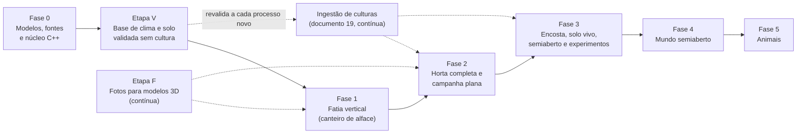

# Mapa do projeto

> Fases, entregáveis e passo a passo do simulador-agro, num só lugar. Lido em toda sessão junto com `CLAUDE.md` e `STATUS.md`. A lista é atualizada a cada sessão.
> 🤖 passo do agente · 👤 passo do usuário (U1 a U4 do `CLAUDE.md` §2) · `médio`, `alto`, `extra` = esforço sugerido (§1.2).
> Estado dos passos. ✅ feito · 🔄 em andamento · ⬜ a fazer · ⚠️ feito, mas precisa melhorar.

## 1. Como o trabalho anda

### 1.1 Regra de autonomia
O usuário não aprova passo a passo. A um "continue", o agente segue os passos pendentes do esforço da sessão, na ordem deste mapa, um PR por item, até acabar o limite da sessão ou chegar a um ponto de parada.

| # | Situação | O que o agente faz |
|---|---|---|
| P1 | Decisão que só o usuário pode tomar (escopo de cultura ou região, política de fontes, gosto didático, prioridade) | Pergunta em uma frase, com a opção recomendada, e segue com o que não depende da resposta |
| P2 | Ação que não dá para desfazer (apagar *branch*, Artifact ou arquivo que não seja dele, reescrever histórico, publicar fora do repositório) | Prepara tudo, descreve a ação e espera o "sim" |
| P3 | Precisa do usuário fisicamente (foto, notebook ligado, aprovação de acesso, login no navegador) | Pede só isso e segue com outro item |
| P4 | CI vermelho que não conserta em 3 tentativas, ou dado que não bate com a publicação citada | Para o item, explica a causa e passa ao seguinte |

Fora desses casos o agente decide, registra a decisão de projeto em `DECISOES.md` e segue. Para abrir uma sessão, anexe o repositório, escolha Opus 5.5 com o esforço do próximo passo (`STATUS` §1) e escreva "Claudinho, continue o simulador-agro."

### 1.2 Esforço

| Nível | Critério |
|---|---|
| `médio` | Trabalho mecânico ou com modelo pronto. O CI pega o erro e refazer é barato |
| `alto` | Desenho com inferência sobre o conteúdo agronômico ou contrato usado por vários módulos |
| `extra` | Fundação. Esquema do conhecimento, modelo solo-planta-atmosfera, arquitetura e revisão cruzada |

Numa sessão de esforço X o agente executa os passos pendentes de nível X. Se um deles depende de um passo de nível menor, ele faz o pré-requisito no escopo mínimo. Ele não executa passo de nível maior que o da sessão.

## 2. Visão das fases

| Fase | Objetivo | Entregável que fecha a fase | Critério de saída | Estado |
|---|---|---|---|---|
| 0 | Escolher modelos, provar a arquitetura e registrar as fontes antes de qualquer cena | Documentos 01 a 21, registro de fontes da fase 1, núcleo C++ determinístico com testes | Revisão cruzada sem contradição. Todo parâmetro da fase 1 com fonte registrada ou rótulo [PROVISÓRIO]. CI verde em Linux e Windows | 🔄 Etapas B e C |
| V | Provar que clima e solo reproduzem a realidade sem nenhuma cultura | Cenários de referência sem cultura rodando no núcleo, com métricas contra dados observados | Astronomia e ET0 batem com os exemplos do FAO-56. Água e temperatura do solo dentro dos limites de aceite do documento 22 nas cinco regiões | ⬜ |
| 1 | Atravessar todas as camadas com o menor conteúdo possível | `.exe` com um canteiro plano de alface, ciclo completo e relatório de safra | Balanço de água e N fecha exato. 1x, 8x, dormir, pular até o evento e save/load dão o mesmo hash. Mesmo hash no Linux e no Windows. ≥ 30 FPS no notebook | ⬜ |
| 2 | Horta completa com campanha que ensina o básico em área plana | Várias culturas, água em camadas, biologia do solo, calagem com tempo de reação, defensivos, compostagem, microtrator, primeira cultura pelo fluxo de ingestão (beterraba) | Campanha plana jogável do início ao fim. Base revalidada com os processos novos. Testes de validação contra as fontes passam | ⬜ |
| 3 | Declividade, solo vivo e propriedade livre para experimentos | Escoamento e erosão na encosta, plantas de cobertura, salinidade, consórcio, modo semiaberto com experimentos e eventos | Erosão e escoamento conservativos e determinísticos. Experimento com ramificação do save mostra diferença só pelo manejo. Eventos sorteados reproduzíveis | ⬜ |
| 4 | Mundo semiaberto com economia e vida | Economia, combustível, NPCs, cidades, deriva, micronutrientes, carbono de longo prazo | Mundo navegável no orçamento de desempenho | ⬜ |
| 5 | Animais ligados ao ciclo de nutrientes | Galinha, tilápia, porcos e gado | Esterco e pastejo fecham o ledger de N e C | ⬜ |

## 3. Fase 0. Base de modelos, fontes e núcleo

**Objetivo.** Decidir o que o simulador calcula, com quais equações, com quais dados e com qual arquitetura de tempo, e provar a arquitetura em código antes de criar o projeto Godot.

### 3.1 Entregáveis

| ID | Entregável | Onde fica | Critério de pronto | Estado |
|---|---|---|---|---|
| E0.1 | Escolha de modelos por fase e dados levantados | `BASE_MODELOS.md` | Matriz C1 a C7, modelos por fase, lacunas com próximo passo | ✅ três rodadas; ⚠️ lacunas da §10 |
| E0.2 | Arquitetura de simulação | `ARQUITETURA_SIMULACAO.md` | Agenda, ordem causal, árbitros, ledger, determinismo, save e testes descritos | ✅ |
| E0.3 | Núcleo C++ determinístico | `engine/native/` | Agenda, relógio, ledger, alocação, RNG de eventos, detmath. Mesmo hash em gcc, clang, MinGW. Teste 1x = 8x = dormir = save/load | ✅ (Windows confirmado pelo CI); astronomia e ET0 do FAO-56 já no núcleo |
| E0.4 | Registro de fontes da fase 1 | `docs/referencias/fontes.json` | Toda publicação usada pela fase 1 registrada com URL, local e licença. Fila vazia para os itens da fase 1 | 🔄 16 registradas, 31 na fila |
| E0.5 | Documentos de planejamento 01 a 21 | `docs/NN_*.md` | Formato do `_MODELO_DOCUMENTO`, verificadores sem erro | 🔄 13 Interface em rascunho |
| E0.6 | Revisão cruzada | todos os `docs/` | Sem contradição; `BASE_MODELOS` e `ARQUITETURA_SIMULACAO` absorvidos e retirados | ⬜ |
| E0.7 | Fluxo de ingestão de cultura | `19_INGESTAO_DE_CULTURA.md` | Fluxo, ficha da cultura, regras de conflito e validação definidos | 🔄 rascunho |

### 3.2 Passo a passo

**Etapa A. Repositório**
- [x] **A1.** 🤖 Repositório criado a partir da infraestrutura do `simulador-normas`.
- [x] **A2.** 🤖 *Ruleset* "Proteção da main" ativo na *branch* padrão. Exige PR, os cinco jobs do CI como *checks*, histórico linear e só *squash*; bloqueia *push* forçado e exclusão da `main`; ninguém na lista de exceção. *Branch* apagada no *merge*. Rótulos `bug`, `conteudo-tecnico` e `desempenho` criados.
- [x] **A3.** 👤 Perguntas iniciais respondidas.

**Etapa B. Base de modelos, fontes e núcleo**
- [x] **B0.1.** 🤖 Primeira pesquisa de modelos.
- [x] **B0.2.** 🤖 Segunda pesquisa (matriz, acoplamento, solo, planta, terreno).
- [x] **B0.3.** 👤 Validação das decisões 26 a 34 (o usuário acatou todas as recomendações).
- [x] **B0.4.** 🤖 Terceira pesquisa (dados da alface, descompactação, determinismo, Terrain3D) e nova análise da arquitetura.
- [x] **B0.5.** 🤖 Quarta pesquisa incorporada. Fontes conferidas na publicação original e registradas; decisões 55 a 59.
- [ ] **B1.** 🔄 🤖 `alto` Esvaziar a fila de verificação do registro para as publicações da fase 1, com página ou tabela de cada valor da `BASE_MODELOS` §4. As fontes da alface, do calcário, da erosão e do solo físico já estão registradas. Faltam os itens da fila e as pendências da `BASE_MODELOS` §10.
- [ ] **B2.** 🤖 `alto` Conferir licença e condição de reprodução de cada publicação (campo `licenca`).
- [ ] **B3.** 🤖 `médio` Levantar as fontes da fase 2 (tomate cereja, compostagem, palhada, Agrofit, aspersão, APSIM SoilWater e SoilNitrogen).
- [x] **B4.** 🤖 Núcleo C++ determinístico com testes e jobs de CI no Linux e no Windows (`engine/native/`).
- [x] **B5.** 🤖 `extra` Astronomia, radiação e ET0 de Penman–Monteith do FAO-56 (diária e horária) no núcleo, com detmath (`engine/native/include/agro/fao56.hpp`). Os exemplos 8 a 13 e 17 a 19 do FAO-56 batem na precisão impressa e o hash de uma grade de entradas é o mesmo em todas as configurações do CI.
- [ ] **B6.** 🤖 `alto` Balanço hídrico diário de uma camada com Curve Number e o compartimento "aplicada hoje" (`ARQUITETURA_SIMULACAO` §4.1), com teste de fechamento do ledger sob sequências aleatórias de ações.

**Etapa V. Base de clima e solo validada sem cultura**

O núcleo C++ não depende do Godot, então a base pode ser construída e validada antes da fase 1 (`CLAUDE.md` §3, regra 3).
- [ ] **V1.** 🤖 `alto` Escolher os cinco cenários de referência (semiárido, Cerrado, Sudeste, Sul e Amazônia) com série climática real e dados observados de solo. A série vem da grade BR-DWGD. O semiárido já tem candidato (Pesqueira, PE); as outras regiões ainda não.
- [ ] **V2.** 🤖 `alto` Executável de linha de comando do núcleo que roda um cenário sem cultura e grava as variáveis diárias em CSV.
- [ ] **V3.** 🤖 `extra` Documento 22 com as métricas do Documentos 381 da Embrapa Cerrados (viés médio, raiz do erro quadrático médio, eficiência, índice d de Willmott e índice c) e limites de aceite por variável.
- [ ] **V4.** 🤖 `alto` Validar astronomia e ET0 (depois de B5).
- [ ] **V5.** 🤖 `alto` Validar o balanço hídrico em solo nu (depois de B6).
- [ ] **V6.** 🤖 `extra` Modelo de temperatura do solo por camada no núcleo e validação contra medidas brasileiras.
- [ ] **V7.** 🤖 `alto` Job de CI que roda os cenários de referência e barra o PR se uma métrica sair do limite.

**Etapa C. Documentos de planejamento (um PR por documento)**

Para cada documento, ler `CLAUDE.md`, `00_INDICE`, `BASE_MODELOS`, `ARQUITETURA_SIMULACAO`, `DECISOES` e os documentos já escritos. Escrever no formato do `_MODELO_DOCUMENTO`, com todo número citado. Rodar os verificadores. PR e *merge* com CI verde.

| Ordem | Documento | Esforço | Estado | Por que nesta posição |
|---|---|---|---|---|
| 1 | 01 Visão e pedagogia | `alto` | ⬜ | Define o que é aprender manejo jogando |
| 2 | 09 Relógio e clima | `extra` | ⬜ | Base dos modelos; absorve `ARQUITETURA_SIMULACAO` §3 |
| 3 | 04 Modelo de conhecimento | `extra` | ⬜ | Formato do conteúdo e das citações |
| 4 | 05 Modelo solo-planta-atmosfera | `extra` | ⬜ | O que torna o mundo calculado |
| 4a | 22 Validação do clima e do solo | `extra` | ⬜ | Critérios que a base precisa cumprir antes de culturas novas |
| 5 | 15 Save, replay e determinismo | `alto` | ⬜ | Absorve `ARQUITETURA_SIMULACAO` §7 e §10 |
| 6 | 14 Pacote inicial | `alto` | ⬜ | Dados reais da fatia vertical |
| 7 | 10 Fitossanidade | `alto` | ⬜ | Daninhas na fase 1; pragas e defensivos na fase 2 |
| 8 | 18 Protagonista e câmera | `alto` | ⬜ | Como o jogador age no mundo |
| 9 | 08 Interação e operações | `alto` | ⬜ | Verbos de `act()` |
| 10 | 07 Catálogo | `alto` | ⬜ | Ferramentas, instrumentos e máquinas |
| 11 | 06 Mundo 3D e terreno | `alto` | ⬜ | Terrain3D 1.1.x e malha de canteiro |
| 12 | 11 Campanha | `alto` | ⬜ | Lições do plano ao inclinado |
| 13 | 12 Avaliação | `alto` | ⬜ | Como o resultado é medido e explicado |
| 14 | 02 Arquitetura geral | `extra` | ⬜ | Consolida contratos; absorve o resto da `ARQUITETURA_SIMULACAO` |
| 15 | 13 Interface | `médio` | 🔄 rascunho | Telas, HUD, caderno, relatório |
| 16 | 03 Plataforma e desempenho | `médio` | ⬜ | Orçamento e vegetação em massa |
| 17 | 17 Pipeline de arte | `médio` | ⬜ | Plantas por estádio e máquinas |
| 18 | 16 Testes e CI | `alto` | ⬜ | Testes do modelo contra as fontes |
| 19 | 21 Roadmap | `médio` | ⬜ | Datas e versões das fases 1 a 5 |
| 20 | 19 Ingestão de cultura e novo pacote | `extra` | 🔄 rascunho | Cultura nova a partir das publicações, sem código |
| 21 | 20 Modo semiaberto, experimentos e eventos | `alto` | ⬜ | Fase 3; laboratório de manejo |
| 22 | Revisão cruzada de `docs/` | `extra` | ⬜ | Absorve e retira `BASE_MODELOS` e `ARQUITETURA_SIMULACAO` |

## 4. Fase 1. Fatia vertical

**Objetivo.** Um canteiro plano de alface jogável do preparo à colheita, com o relatório de safra explicando cada perda. A fatia expõe cedo os erros de arquitetura.

### 4.1 Entregáveis

| ID | Entregável | Critério de pronto |
|---|---|---|
| E1.1 | Projeto Godot com GDExtension do núcleo | Compila para Windows com MinGW no CI; `.exe` abre no notebook |
| E1.2 | Modelos da fase 1 no núcleo | Astronomia, ET0, balanço hídrico com CN, laudo e calagem por saturação por bases, N mineral com lixiviação, AquaCrop simplificado, daninha com Cousens. Testes contra valores das fontes |
| E1.3 | Protagonista e canteiro | Primeira e terceira pessoa, um canteiro plano com grade agronômica, ferramentas da fatia |
| E1.4 | `act()` e as operações da fatia | Análise de solo, calagem, adubação, plantio, rega, gotejo, capina, leitura do tensiômetro, colheita |
| E1.5 | Interface da fatia | HUD, caderno de campo, laudo com prazo, relatório de safra com raio-x (documento 13) |
| E1.6 | Save, carga e replay | Mesmo hash diário depois de carregar e no replay |
| E1.7 | Medidas no notebook | FPS ≥ 30 e custo por célula medido |

### 4.2 Passo a passo

**Etapa D. Esqueleto Godot e fatia vertical**
- [ ] **D1.** 🤖 `médio` Projeto Godot 4.7.2 (Compatibility), gdUnit4, godot-cpp fixado, GDExtension do `agro_core` compilada com MinGW-w64 no CI, exportação do `.exe` Windows.
- [ ] **D1a.** 🤖 `extra` Ponte `step_to`, `act`, `read`, `save`, `load`. Relógio com 1x a 8x, limite por quadro, dormir e, na campanha, pular até o evento. Teste 1x × 8x dentro do Godot.
- [ ] **D2.** 🤖 `médio` Abrir o primeiro `.exe` da Release no notebook (P3).
- [ ] **D1b.** 🤖 `médio` Benchmark do passo diário em C++ com 100, 500 e 1000 células no notebook.
- [ ] **D3.** 🤖 `alto` Save e carga com manifesto JSON e bloco binário, registro de ações, replay e migração de versão.
- [ ] **D4.** 🤖 `extra` Carregador e validador do pacote (documento 04).
- [ ] **D5.** 🤖 `extra` Modelos da fase 1 no núcleo (`BASE_MODELOS` §3.1), com testes contra valores das fontes.
- [ ] **D6.** 🤖 `médio` Propriedade com um canteiro plano e protagonista em primeira e terceira pessoa.
- [ ] **D7.** 🤖 `alto` `act()` com as operações da fatia.
- [ ] **D8.** 🤖 `alto` Interface da fatia e relatório de safra com raio-x.
- [ ] **D9.** 🤖 `médio` Jogar no notebook e medir o FPS (painel F3). 👤 U2 jogar e dizer o que ficou confuso.

**Etapa E. Ciclo de correção (repetido)**
- [ ] **E1.** 👤 U2 conta o problema. 🤖 `médio` O agente busca o log no notebook e abre a issue.
- [ ] **E2.** 🤖 Corrigir em *branch*, PR, CI verde, *merge* e Release numerada. Esforço do passo que produziu a parte com defeito.

## 5. Fase 2. Horta completa e campanha plana

**Objetivo.** Várias culturas e o manejo completo da horta em área plana, com uma campanha que ensina o básico passo a passo.

| ID | Entregável | Critério de pronto |
|---|---|---|
| E2.1 | Água em várias camadas (cascata, componente SoilWater do APSIM como referência) | Fecha o ledger por camada; reproduz o *bucket* da fase 1 com uma camada |
| E2.2 | Planta híbrida (mínimo entre luz e água) e árbitro de luz | Alface volta ao comportamento da fase 1 sem competição |
| E2.3 | Daninhas com o código da planta | Reproduz a hipérbole de Cousens como teste |
| E2.4 | Calcário com cinética, pH–V e NPK por formulação | Tempo de reação ensinado na campanha |
| E2.5 | Biologia do solo (matéria orgânica em compartimentos, mineralização e imobilização de N) | Componente SoilNitrogen do APSIM avaliado como referência; validado contra incubações brasileiras na Etapa V |
| E2.6 | Séries INMET de vários anos e regiões | Brasil inteiro sem gerador climático |
| E2.7 | Densidade do solo por preparo e tráfego, deformação do terreno, Terrain3D 1.1.x | Malha de 5 cm por canteiro dentro do orçamento |
| E2.8 | Defensivos do Agrofit com carência e meia-vida corrigida | DT50 com fonte ou [PROVISÓRIO] |
| E2.9 | Compostagem, palhada com Kc dual, aspersão com molhamento foliar (passo horário) | Passo horário entra na agenda sem mudar os outros módulos |
| E2.10 | Microtrator e tomate cereja | Cultura nova só com dados |
| E2.11 | Campanha plana | Lições do documento 11 jogáveis |
| E2.12 | Piloto do fluxo de ingestão com a beterraba | Pacote gerado a partir das publicações, validado pelo documento 19, sem código novo |

Passo a passo (Etapa G).
- [ ] **G1.** 🤖 `extra` Água em camadas e passo horário na agenda.
- [ ] **G2.** 🤖 `extra` Planta híbrida, árbitro de luz e daninhas com o código da planta.
- [ ] **G3.** 🤖 `alto` Química da fase 2 (calcário, pH–V, NPK, mineralização).
- [ ] **G4.** 🤖 `alto` Pacotes de clima de várias regiões.
- [ ] **G5.** 🤖 `alto` Solo físico simples e deformação do terreno.
- [ ] **G6.** 🤖 `alto` Defensivos, compostagem, palhada e aspersão.
- [ ] **G7.** 🤖 `médio` Microtrator e tomate cereja. 👤 U1 fotos das ferramentas e do microtrator.
- [ ] **G8.** 🤖 `alto` Campanha plana. 👤 U2 jogar a campanha.
- [ ] **G9.** 🤖 `extra` Piloto de ingestão com a beterraba. 👤 U4 validar o conteúdo e U1 mandar fotos por estádio.

## 6. Fase 3. Encosta, solo vivo e modo semiaberto

**Objetivo.** A declividade passa a pesar e a propriedade fica livre para o jogador.

| ID | Entregável | Critério de pronto |
|---|---|---|
| E3.1 | Operador lateral (D8 com Priority-Flood), MUSLE e práticas conservacionistas | Conservativo em inteiros, sem restrição de CFL |
| E3.2 | RP, IHO e bioporos com plantas de cobertura | Nabo reproduz os alvos de Nicoloso et al. 2008 |
| E3.3 | Troca de Gapon e salinidade | Salinidade emerge do balanço no semiárido irrigado |
| E3.4 | Fósforo e húmus em dois compartimentos | Adubação fosfatada perde disponibilidade em Latossolo argiloso |
| E3.5 | Consórcio e banco de sementes de daninhas | Partição de luz por estrato |
| E3.6 | Modo semiaberto, gerador climático e eventos | Eventos reproduzíveis pela semente |
| E3.8 | Modo experimento | Tratamentos, repetições e blocos sobre a variação espacial do solo; ramificação do save com o mesmo clima; comparação no caderno |
| E3.7 | ZARC na época de plantio | Janela por município |

Passo a passo (Etapa H).
- [ ] **H1.** 🤖 `extra` Operador lateral e erosão.
- [ ] **H2.** 🤖 `extra` Solo físico completo e plantas de cobertura.
- [ ] **H3.** 🤖 `alto` Química da fase 3.
- [ ] **H4.** 🤖 `alto` Consórcio e banco de sementes.
- [ ] **H5.** 🤖 `alto` Modo semiaberto, gerador climático e eventos.
- [ ] **H7.** 🤖 `alto` Modo experimento com ramificação do save.
- [ ] **H6.** 🤖 `médio` ZARC. 👤 U2 jogar na encosta.

## 7. Fase 4. Mundo semiaberto

| ID | Entregável |
|---|---|
| E4.1 | Economia, mercado e combustível |
| E4.2 | NPCs e cidades |
| E4.3 | Gases e deriva de aplicação |
| E4.4 | Micronutrientes por tabelas de especiação geradas offline com o PHREEQC |
| E4.5 | Carbono de longo prazo (RothC) |
| E4.6 | Epidemiologia espacial de pragas e doenças |
| E4.7 | Água visual por *virtual pipes*, sem efeito no ledger |

Passo a passo (Etapa I). Detalhado quando a fase 3 terminar.

## 8. Fase 5. Animais

| ID | Entregável |
|---|---|
| E5.1 | Galinha, tilápia, porcos e gado |
| E5.2 | Esterco no ledger de N e C e ligação com a compostagem |
| E5.3 | Pastejo como consumidor no árbitro de recurso |
| E5.4 | Compactação por pisoteio com a mesma equação do tráfego |

Passo a passo (Etapa J). Detalhado quando a fase 4 terminar.

## 9. Etapa F. Fotos para modelos 3D (contínua)
- [ ] **F1.** 👤 U1 manda a foto. Objeto inteiro, de frente e de lado, fundo limpo e, se der, uma medida conhecida, sem pessoas ou documentos.
- [ ] **F2.** 🤖 `médio` Script `art/blender/<objeto>.py` (`CLAUDE.md` §6), `.glb` e prévia `.png`.
- [ ] **F3.** 👤 U1 responde "parece / não parece".
- [ ] **F4.** 🤖 `médio` Integrar ao catálogo, dentro do orçamento de polígonos (`00_INDICE` §3.3).

## 10. O que precisa de melhora agora

| # | Ponto fraco | Por que importa | Onde se resolve |
|---|---|---|---|
| 1 | Parâmetros de dossel, Ky, RUE e N crítico da alface estrangeiros | O ciclo brasileiro de verão e as cultivares tropicais podem ter outro comportamento | B1 e G2 |
| 2 | 13 publicações na fila de verificação e pendências da `BASE_MODELOS` §10 | Item da fila não pode entrar no pacote | B1 |
| 3 | Descompactação calibrada só para o nabo e sem persistência | Maior risco de credibilidade da fase 3 | H2 |
| 4 | Eficiência do regador sem fonte; aspersão ainda não transcrita | É a primeira ferramenta da fatia | B1 |
| 5 | Documentos 01 a 21 ainda não escritos | O projeto Godot só começa depois da Etapa C | Etapa C |
| 6 | Custo por célula só estimado | A escolha do tamanho da grade depende dele | D1b |
| 7 | Dados observados para os cenários de referência fora do semiárido | Sem eles o simulador não serve para tirar conclusões sem propriedade | V1 |
| 8 | Temperatura do solo sem dado brasileiro de validação | Mineralização, germinação de daninhas e degradação de defensivos dependem dela | V6 |
